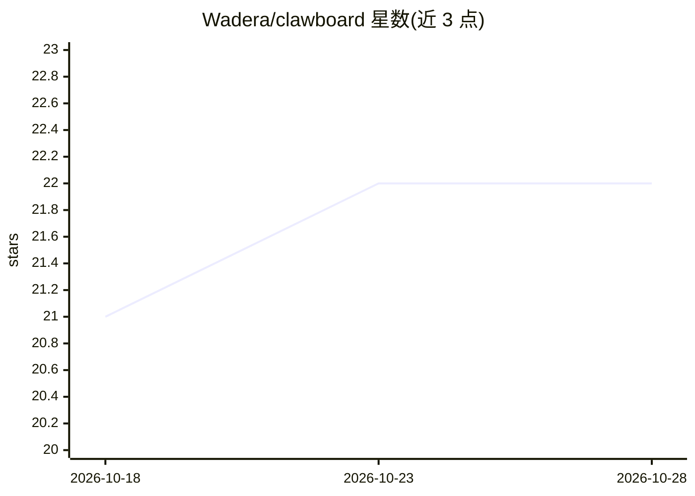

# Wadera/clawboard

⭐ 22 · TypeScript · NOASSERTION · 推送 2026-07-27 · [GitHub](https://github.com/Wadera/clawboard) · 个人维护

**自托管 AI agent 看板：任务、项目、会话与实时监控一体**

基于 React/Node.js/PostgreSQL 的 Web 仪表盘，为 OpenClaw 与 Hermes harness 上的 AI agent 提供看板式任务管理、项目管理、日志、会话记录浏览与实时 agent 状态监控（WebSocket）。全部 Web 功能通过 REST/OpenAPI 与 CLI 暴露，供任意 agent 调用；附 clawbeat 心跳监控脚本（Python 3 标准库，检测卡住任务并输出编排指令）与 Docker 容器化插件系统。以 Docker Compose 部署为主，需已运行 OpenClaw。原生 MCP 连接在路线图中，尚未提供。

## 筛选速览

| 维度 | 判定 | 备注 |
|---|---|---|
| AI 角色 | `ai-ecosystem` | LLM/agent 周边工具 |
| 许可风险 | `permissive` | NOASSERTION |
| 部署形态 | `self-host` | docker 或自建部署 |
| 模型依赖 | — | README 未给出锁定关系 |
| 硬件要求 | — | 无带数字的原话,不猜 |
| 安装摩擦 | `low` | 无编译、无系统依赖或容器化 |
| 成熟度 | — | 结构信号不足 |

## 能力要点

- 看板任务管理与项目、日志、会话记录、统计
- 跨 harness（Hermes/OpenClaw）实时 agent 状态监控
- 全部功能经 REST/OpenAPI + CLI 暴露，任意 agent 可驱动
- clawbeat 心跳监控：卡住任务检测、重试升级、自动生成 spawn 指令

## 适用场景

- 在统一界面管理多个 AI agent 的任务与项目
- 实时监控 agent 运行状态与会话记录
- 通过 CLI/API 让 agent 直接操作看板

## 场景标签

 · 领域:AI agent 管理工具

## 证据(README 行号)

> L7: It began as a dashboard **for OpenClaw**, grew to make **Hermes** its primary harness, and is heading toward being *
> L21: - **🤖 Real-time Agent Status** — Monitor your agents' activity, connections, and health across harnesses (Hermes & 
> L279: - **Execution harnesses:** Agents run through **Hermes** (primary) or **OpenClaw**, selected per task via executio

## 星数曲线

2026-10-18 21 → 2026-10-28 22（+1）

---
*卡片 v1 · prompt 1.4 · 生成 2026-10-28 · 置信度 high · 依据 README sha `db2097542a08` · [字段定义](../../DATASET.md)*
