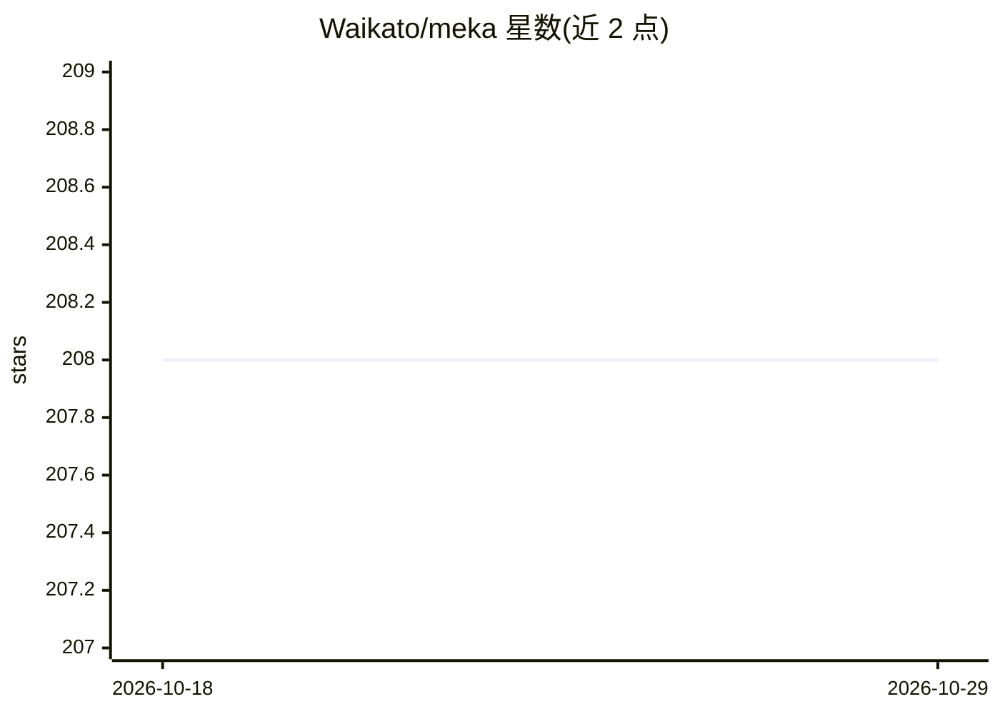

# Waikato/meka

⭐ 208 · Java · GPL-3.0 · 推送 2026-07-17 · [GitHub](https://github.com/Waikato/meka) · [官网](http://waikato.github.io/meka/) · 组织维护

**基于 Weka 的多标签学习与评测开源实现**

Waikato 大学维护的 Java 开源项目，在 Weka 机器学习框架上实现多标签（multi-label）与多目标学习方法及评测流程，附带命令行工具供直接运行分类与评估。面向从事多标签分类研究的开发者与科研人员。文档包括教程 PDF、方法清单与命令行示例、以及 Java 代码调用示例。README 本身未给出安装命令，安装途径需查阅其教程文档。

## 筛选速览

| 维度 | 判定 | 备注 |
|---|---|---|
| AI 角色 | `ai-native` | 本体是模型或模型工具 |
| 许可风险 | `viral` | GPL-3.0 |
| 部署形态 | `None` |  |
| 模型依赖 | — | README 未给出锁定关系 |
| 硬件要求 | — | 无带数字的原话,不猜 |
| 安装摩擦 | `low` | 无编译、无系统依赖或容器化 |
| 成熟度 | — | 结构信号不足 |

## 能力要点

- 提供多标签学习方法与评测程序的开源实现
- 基于 Weka 机器学习框架，可用 Java 代码调用
- 提供命令行示例与教程文档（Tutorial.pdf）

## 适用场景

- 在多标签/多目标数据集上训练和评估分类器
- 通过命令行直接运行多标签分类方法
- 在 Java 项目中集成多标签学习功能

## 场景标签

`模型评测` · 领域:评测与运维

## 证据(README 行号)

> L3: The MEKA project provides an open source implementation of methods for multi-label learning and evaluation.
> L15: * For examples on how to use MEKA in your Java code: https://github.com/Waikato/meka/tree/master/src/main/java/meka

## 星数曲线

2026-10-18 208 → 2026-10-29 208（+0）

---
*卡片 v1 · prompt 1.4 · 生成 2026-10-22 · 置信度 mid · 依据 README sha `ead12cf3ff63` · [字段定义](../../DATASET.md)*
