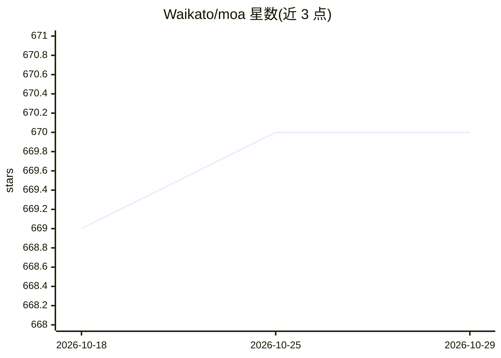

# Waikato/moa

⭐ 670 · Java · GPL-3.0 · 推送 2026-10-26 · [GitHub](https://github.com/Waikato/moa) · [官网](http://moa.cms.waikato.ac.nz/) · 组织维护

**大数据流挖掘框架：提供流式机器学习算法与评测工具**

Java 编写的大数据流挖掘开源框架，与 WEKA 项目相关。内置分类、回归、聚类、离群点检测、概念漂移检测和推荐系统等机器学习算法集合，并提供评测工具；支持实时流挖掘与大规模机器学习，可扩展新算法、新流生成器与新评测指标，目标是为流挖掘社区提供基准套件。由怀卡托大学团队维护，经 Maven Central 与 DockerHub 分发，可引用 2010 年 JMLR 论文。

## 筛选速览

| 维度 | 判定 | 备注 |
|---|---|---|
| AI 角色 | `ai-native` | 本体是模型或模型工具 |
| 许可风险 | `viral` | GPL-3.0 |
| 部署形态 | `None` |  |
| 模型依赖 | — | README 未给出锁定关系 |
| 硬件要求 | — | 无带数字的原话,不猜 |
| 安装摩擦 | `low` | 无编译、无系统依赖或容器化 |
| 成熟度 | — | 结构信号不足 |

## 能力要点

- 涵盖分类/回归/聚类/离群检测/概念漂移检测/推荐系统的算法集合
- 支持实时大数据流挖掘与大规模机器学习
- 可扩展新算法、流生成器与评测指标
- 为流挖掘社区提供基准评测套件

## 适用场景

- 在数据流上实时运行分类、聚类等机器学习算法
- 评测与对比流挖掘算法的概念漂移表现
- 扩展自定义流挖掘算法并做基准测试

## 场景标签

`模型评测` · 领域:评测与运维

## 证据(README 行号)

> L9: MOA is the most popular open source framework for data stream mining, with a very active growing community (blog). I
> L20: MOA performs BIG DATA stream mining in real time, and large scale machine learning. MOA can be extended with new mi

## 星数曲线

2026-10-18 669 → 2026-10-29 670（+1）

---
*卡片 v1 · prompt 1.4 · 生成 2026-10-21 · 置信度 mid · 依据 README sha `88d8ce97c51a` · [字段定义](../../DATASET.md)*
