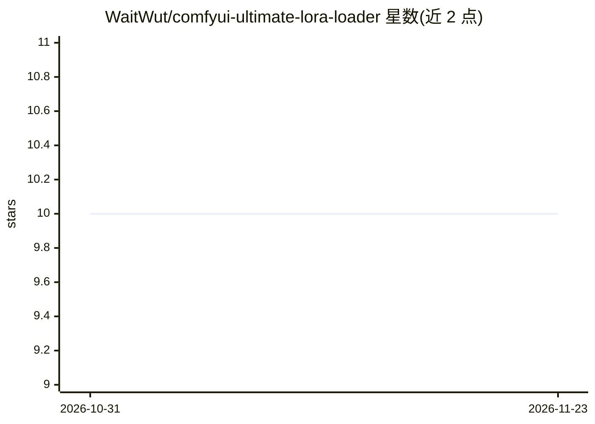

# WaitWut/comfyui-ultimate-lora-loader

⭐ 10 · JavaScript · MIT · 推送 2026-07-29 · [GitHub](https://github.com/WaitWut/comfyui-ultimate-lora-loader) · [官网](https://registry.comfy.org/nodes/ultimate-lora-loader) · 个人维护

**ComfyUI 堆叠式 LoRA 加载节点：文件夹浏览与逐行强度调节**

面向 ComfyUI 用户的自定义节点：Add Lora 弹出真实文件夹浏览器替代扁平下拉列表，支持子目录导航与面包屑返回；每个 LoRA 行独立设置 model 与 CLIP 强度、拖拽排序或按优先级跳转、批量开关/删除；保存的工作流中文件丢失时标红提示并可点击替换。无额外 Python 依赖，通过 git clone 或 ZIP 放入 custom_nodes 后重启 ComfyUI 加载，树形结构缓存 15 秒后自动刷新。

## 筛选速览

| 维度 | 判定 | 备注 |
|---|---|---|
| AI 角色 | `ai-ecosystem` | LLM/agent 周边工具 |
| 许可风险 | `permissive` | MIT |
| 部署形态 | `None` |  |
| 模型依赖 | — | README 未给出锁定关系 |
| 硬件要求 | — | 无带数字的原话,不猜 |
| 安装摩擦 | `low` | 无编译、无系统依赖或容器化 |
| 成熟度 | — | 结构信号不足 |

## 能力要点

- Add Lora 弹窗镜像 models/loras 真实目录结构，支持面包屑导航
- 每行独立的 model/CLIP 双强度列，连接 clip 即出现
- 拖拽排序与优先级字段控制应用顺序
- 缺失文件检测：丢失的 LoRA 行标红并可点击替换

## 适用场景

- 按角色/风格分文件夹管理大量 LoRA 时浏览加载
- 组合多个 LoRA 并分别调节模型与 CLIP 强度
- 迁移工作流后快速定位并替换失效的 LoRA 文件

## 场景标签

`图像生成` · 领域:内容生成

## 证据(README 行号)

> L5: A dynamic LoRA-stack loader for ComfyUI, in the spirit of rgthree's Power Lora Loader, with one core difference: cli
> L41: ## Install

## 星数曲线

2026-10-31 10 → 2026-11-23 10（+0）

---
*卡片 v1 · prompt 1.4 · 生成 2026-11-20 · 置信度 high · 依据 README sha `eeefceb0b74a` · [字段定义](../../DATASET.md)*
