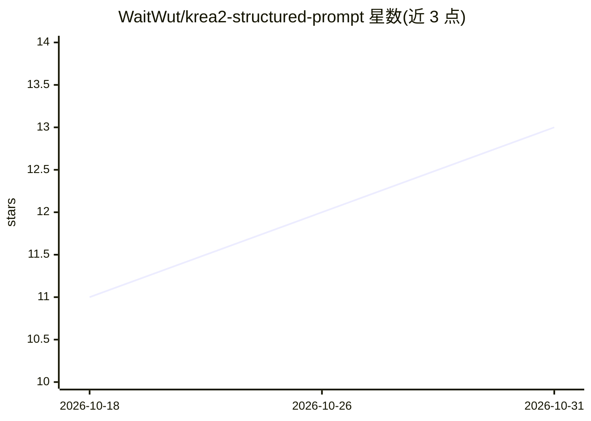

# WaitWut/krea2-structured-prompt

⭐ 13 · JavaScript · MIT · 推送 2026-07-29 · [GitHub](https://github.com/WaitWut/krea2-structured-prompt) · [官网](https://registry.comfy.org/nodes/krea2-structured-prompt) · 个人维护

**面向 Krea-2 的 ComfyUI 结构化提示词构建节点**

一个 ComfyUI 自定义节点，供使用 Krea-2/K2 文生图模型的用户以结构化字段（场景、任意数量角色、构图、光线、风格）填写内容，节点按 Krea-2 训练顺序自动组装成两段连贯散文式提示词，可接入 ethanfel 的 Text Encode (Krea2)。节点不实现编码器本身，只生成输入字符串。角色数量无上限，超过约 5 个时显示提示但不阻断。零依赖，纯标准库实现。

## 筛选速览

| 维度 | 判定 | 备注 |
|---|---|---|
| AI 角色 | `ai-ecosystem` | LLM/agent 周边工具 |
| 许可风险 | `permissive` | MIT |
| 部署形态 | `library` | 以包/库形式分发 |
| 模型依赖 | — | README 未给出锁定关系 |
| 硬件要求 | — | 无带数字的原话,不猜 |
| 安装摩擦 | `low` | 无编译、无系统依赖或容器化 |
| 成熟度 | — | 结构信号不足 |

## 能力要点

- 结构化字段按 Krea-2 训练顺序组装为两段散文提示词
- 动态角色列表，每角色含 who/pose/clothing 三个子字段，拖拽排序
- 每字段含 5 条预设示例下拉，覆盖已有输入前先确认
- prompt_json 调试输出，零外部依赖

## 适用场景

- 在 ComfyUI 中为 Krea-2 生成符合其训练格式的提示词
- 不写自由文本、用表单方式管理多角色场景的提示词
- 通过 JSON 输出调试或复用字段值

## 场景标签

`提示工程` · 领域:Agent 开发

## 证据(README 行号)

> L5: A structured prompt-builder node for ComfyUI, tuned for **Krea-2 / K2**. Instead of writing freehand prose, you fill
> L7: This node **does not replace or re-implement** that encoder — it only builds the string that goes into it.

## 星数曲线

2026-10-18 11 → 2026-10-31 13（+2）

---
*卡片 v1 · prompt 1.4 · 生成 2026-10-31 · 置信度 mid · 依据 README sha `6e5650919f15` · [字段定义](../../DATASET.md)*
