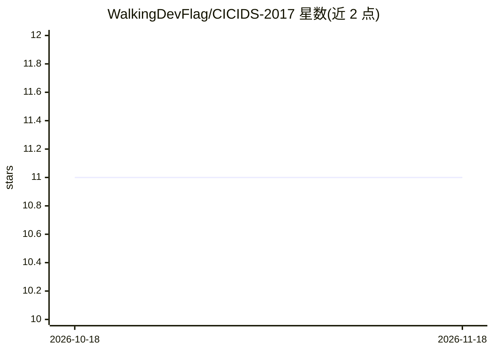

# WalkingDevFlag/CICIDS-2017

⭐ 11 · Jupyter Notebook · MIT · 推送 2026-06-14 · [GitHub](https://github.com/WalkingDevFlag/CICIDS-2017) · 个人维护

**面向入侵检测研究者的 CICIDS 2017 数据集分析 notebook 集**

一组 Jupyter notebooks，围绕 CICIDS 2017 入侵检测数据集提供下载自动化、探索性数据分析、预处理，以及多种分类模型训练：包括逻辑回归、SVM、KNN、随机森林、决策树，以及 MLP、CNN、DNN 等深度学习结构，覆盖二分类与多分类任务。使用方式为 clone 仓库后按 notebook 内指引执行，环境通过 Conda 与 pip 安装。

## 筛选速览

| 维度 | 判定 | 备注 |
|---|---|---|
| AI 角色 | `ai-knowledge` | 知识聚合/清单类 |
| 许可风险 | `permissive` | MIT |
| 部署形态 | `library` | 以包/库形式分发 |
| 模型依赖 | — | README 未给出锁定关系 |
| 硬件要求 | — | 无带数字的原话,不猜 |
| 安装摩擦 | `low` | 无编译、无系统依赖或容器化 |
| 成熟度 | — | 结构信号不足 |

## 能力要点

- 自动下载 CICIDS 2017 数据集
- EDA 与数据预处理流程
- 支持 5 种经典机器学习分类器
- 支持 MLP/CNN/DNN 深度学习模型训练

## 适用场景

- 复现 CICIDS 2017 上的入侵检测分类实验
- 学习网络流量数据的 EDA 与预处理流程
- 对比传统机器学习与深度学习在该数据集上的表现

## 场景标签

`网络安全` `教程课程` · 领域:学习与行业

## 证据(README 行号)

> L4: This repository contains Jupyter notebooks designed for analyzing the CICIDS 2017 dataset, which focuses on intrusio
> L9: - **Model Training**:
> L12:  - **Deep Learning**: Multi-Layer Perceptron, Convolutional Neural Network, Deep Neural Network for both binary and

## 星数曲线

2026-10-18 11 → 2026-11-18 11（+0）

---
*卡片 v1 · prompt 1.4 · 生成 2026-11-18 · 置信度 high · 依据 README sha `02b6c4f543e9` · [字段定义](../../DATASET.md)*
