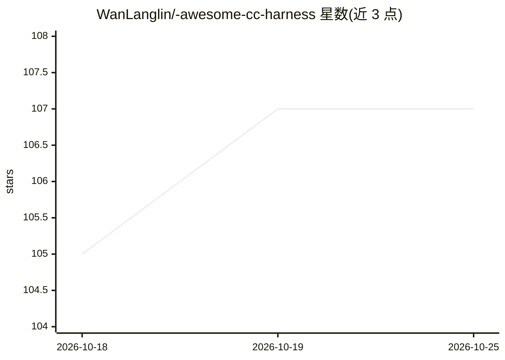

# WanLanglin/-awesome-cc-harness

⭐ 107 · Python · NOASSERTION · 推送 2026-05-01 · [GitHub](https://github.com/WanLanglin/-awesome-cc-harness) · 个人维护 · 中文 README

**Claude Code 源码逆向分析教程：16 章 Harness Engineering 中英双语指南**

对 Claude Code 全部 512,664 行 TypeScript 源码的逆向分析知识库：以 16 章（约 50,000 字、147 个代码块、77 张图）拆解其 Agent Loop、工具系统、权限模型、沙盒与上下文工程等设计；并含两项独立发现章节（Grove 训练数据管道、5 层反蒸馏防御）。第 15 章提供 200 行 Python 实现可运行 Harness 的动手教程，第 16 章做 Claude Code/Cursor/Copilot 对比。面向做 AI Agent 的开发者与研究人员阅读，本身不含可安装运行的软件，仅为在线阅读内容，许可见限教育与研究用途。

## 筛选速览

| 维度 | 判定 | 备注 |
|---|---|---|
| AI 角色 | `ai-knowledge` | 知识聚合/清单类 |
| 许可风险 | `none` | NOASSERTION |
| 部署形态 | `None` |  |
| 模型依赖 | — | README 未给出锁定关系 |
| 硬件要求 | — | 无带数字的原话,不猜 |
| 安装摩擦 | `low` | 无编译、无系统依赖或容器化 |
| 成熟度 | — | 结构信号不足 |

## 能力要点

- 覆盖 Claude Code 512K 行源码的 16 章中英双语分析
- Grove 训练数据管道与 5 层反蒸馏防御两项机制分析
- 第 15 章含 200 行 Python 从零实现可运行 Harness
- 第 16 章为 Claude Code vs Cursor vs Copilot 12 维对比

## 适用场景

- 学习 Claude Code 的 Agent Loop 与权限模型实现方式
- 了解 Anthropic 的训练数据收集与反蒸馏机制
- 动手构建自己的 agent harness 原型

## 场景标签

`教程课程` · 领域:学习与行业

## 证据(README 行号)

> L10: > **Reverse-engineering all 512,664 lines of Claude Code's TypeScript source** — agent loop, tool system, permissio
> L25: > 基于 Claude Code 全部 512,664 行 TypeScript 源码的系统性逆向分析，拆解 Anthropic 在 Agent Loop、工具系统、权限模型、沙盒安全、上下文工程等方面的设计决策与工程取舍。
> L72: 16 章 · ~50,000 字 · 147 段代码块 · 77 张图表 · 中英双语

## 星数曲线

2026-10-18 105 → 2026-10-25 107（+2）

---
*卡片 v1 · prompt 1.4 · 生成 2026-10-23 · 置信度 high · 依据 README sha `85dae969a597` · [字段定义](../../DATASET.md)*
