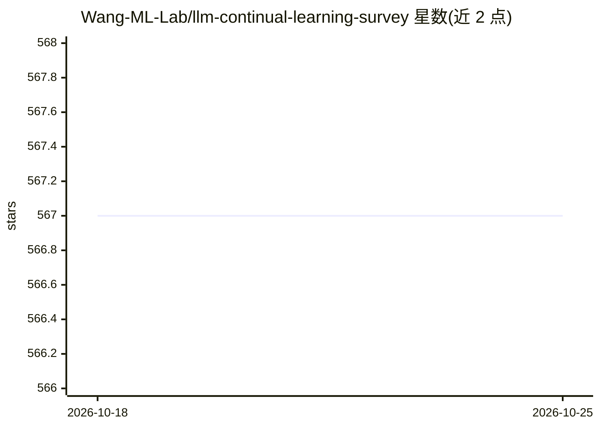

# Wang-ML-Lab/llm-continual-learning-survey

⭐ 567 · 推送 2025-12-23 · [GitHub](https://github.com/Wang-ML-Lab/llm-continual-learning-survey) · 组织维护

**LLM 持续学习论文综述清单（CSUR 2025，持续更新）**

ACM Computing Surveys 2025 论文 "Continual Learning of Large Language Models: A Comprehensive Survey" 的配套仓库，按月收录新论文并持续更新。条目按持续预训练（CPT）、领域自适应预训练（DAP）等主题组织，DAP 下细分通用、法律、医疗、金融、科学、代码与语言等子领域，每条含论文标题并附 paper/code/huggingface/demo 等链接。面向持续学习与 LLM 研究者，接受 PR 与 issue 贡献。

## 筛选速览

| 维度 | 判定 | 备注 |
|---|---|---|
| AI 角色 | `ai-knowledge` | 知识聚合/清单类 |
| 许可风险 | `none` | — |
| 部署形态 | `None` |  |
| 模型依赖 | — | README 未给出锁定关系 |
| 硬件要求 | — | 无带数字的原话,不猜 |
| 安装摩擦 | `low` | 无编译、无系统依赖或容器化 |
| 成熟度 | — | 结构信号不足 |

## 能力要点

- 对应 CSUR 2025 已发表综述并按月更新补充新论文
- 按 CPT/DAP 分类，DAP 细分法律、医疗、金融、科学、代码、语言等领域
- 多数条目附 paper/code/huggingface 链接
- 开放 PR 与 issue 贡献

## 适用场景

- 查找 LLM 持续学习/持续预训练方向的论文
- 按应用领域（医疗、金融、科学等）检索领域自适应预训练工作
- 跟踪该方向的最新论文动态

## 场景标签

`精选清单` · 领域:学习与行业

## 证据(README 行号)

> L1: # Continual Learning of Large Language Models: A Comprehensive Survey
> L2: This is an updating survey for Continual Learning of Large Language Models (CL-LLMs), a constantly updated and exten
> L35: ## Continual Pre-Training of LLMs (CPT)

## 星数曲线

2026-10-18 567 → 2026-10-25 567（+0）

---
*卡片 v1 · prompt 1.4 · 生成 2026-10-22 · 置信度 high · 依据 README sha `0eb0ce9b7c99` · [字段定义](../../DATASET.md)*
