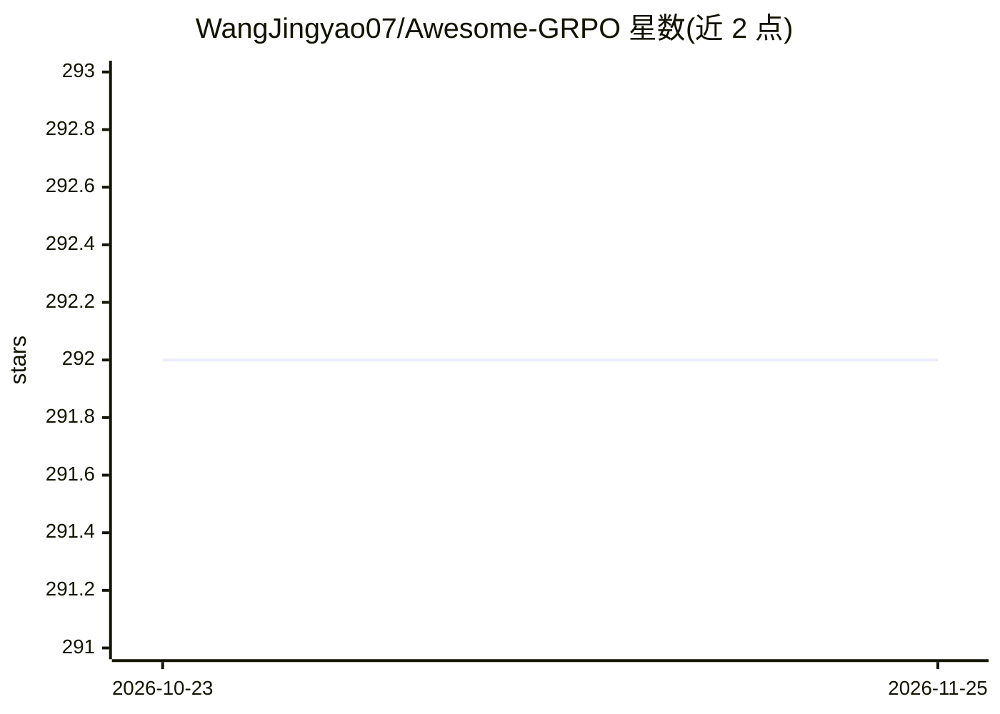

# WangJingyao07/Awesome-GRPO

⭐ 292 · Python · 推送 2026-11-12 · [GitHub](https://github.com/WangJingyao07/Awesome-GRPO) · 个人维护

**面向 LLM 强化微调研究者的 GRPO 及其变体实现与论文合集**

策展型仓库，包含两部分：CODE 目录提供 GRPO 及 8 种已实现变体（DAPO、Dr.GRPO、GSPO、GMPO、GTPO 等）的可切换训练实现，通过单个 flag 切换优化规则，集成 DeepSpeed 分布式微调、vLLM 推理与 WandB 日志；papers 目录收录 GRPO 相关论文 PDF 与摘要对比。另有推断期评测脚本 infer.py。随仓库附带关联论文引用条目。

## 筛选速览

| 维度 | 判定 | 备注 |
|---|---|---|
| AI 角色 | `ai-ecosystem` | LLM/agent 周边工具 |
| 许可风险 | `none` | — |
| 部署形态 | `None` |  |
| 模型依赖 | local-ok | 支持本地模型 |
| 硬件要求 | — | 无带数字的原话,不猜 |
| 安装摩擦 | `low` | 无编译、无系统依赖或容器化 |
| 成熟度 | — | 结构信号不足 |

## 能力要点

- 8 种 GRPO 变体的可运行实现，单 flag 切换优化规则
- DeepSpeed ZeRO-2/3 分布式微调与 vLLM 推理集成
- papers/ 目录收录 GRPO 系论文 PDF 与摘要对比
- infer.py 提供评测脚本

## 适用场景

- 为 LLM 强化微调实验选择并运行不同 GRPO 变体
- 查阅 GRPO 及其变体的论文与思路对比
- 基于现有管线快速复现 DAPO/GSPO 等方法

## 场景标签

`强化学习` `微调` `精选清单` · 领域:学习与行业

## 证据(README 行号)

> L5: 🔥 A curated and extensible repository for **GRPO** and its **variants**, combining both *code implementations* and *
> L62: **CODE** provides a concise, switchable implementation of GRPO and its variants, allowing to switch optimization ru
> L75: * ✅ **DeepSpeed ZeRO-2/3** for distributed fine-tuning

## 星数曲线

2026-10-23 292 → 2026-11-25 292（+0）

---
*卡片 v1 · prompt 1.4 · 生成 2026-11-25 · 置信度 mid · 依据 README sha `90fe8a4c0f8e` · [字段定义](../../DATASET.md)*
