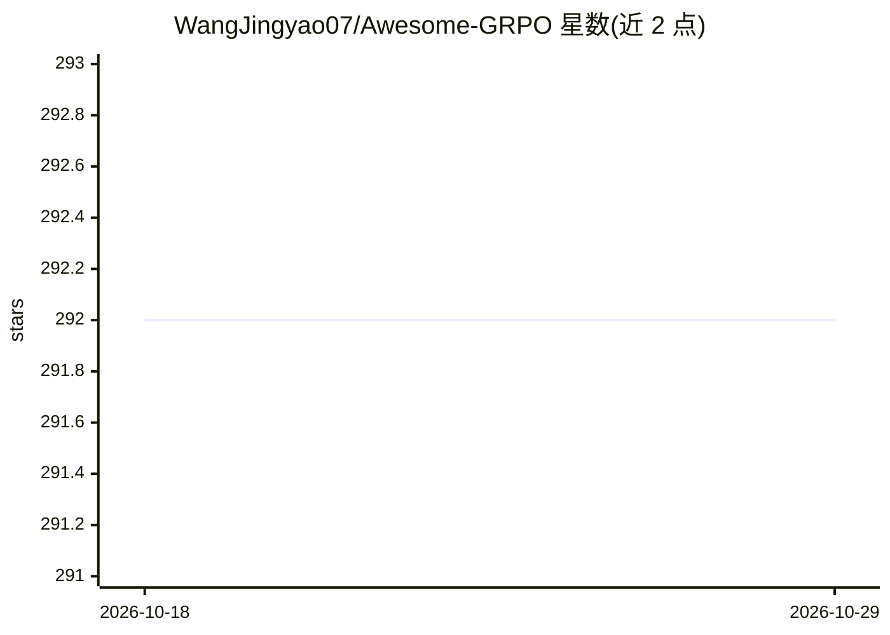

# WangJingyao07/Awesome-GRPO

⭐ 292 · Python · 推送 2025-12-06 · [GitHub](https://github.com/WangJingyao07/Awesome-GRPO) · 个人维护

**GRPO 及其变体的代码实现与论文资源合集**

面向 LLM 强化微调研究者的 GRPO 资源库：CODE/ 目录提供 GRPO、DAPO、Dr.GRPO、2-GRPO、GTPO 等变体的可切换实现（单个 flag 切换优化规则），集成 DeepSpeed ZeRO-2/3 分布式微调、vLLM 推理引擎、KL 正则控制与 WandB 日志；papers/ 目录收录相关论文 PDF 与对比总结，另有 infer.py 用于评测。部分变体（如 TreePO、GiGPO）仅收录论文与总结，代码标注为后续计划。通过 git clone 源码使用。

## 筛选速览

| 维度 | 判定 | 备注 |
|---|---|---|
| AI 角色 | `ai-ecosystem` | LLM/agent 周边工具 |
| 许可风险 | `none` | — |
| 部署形态 | `None` |  |
| 模型依赖 | local-ok | 支持本地模型 |
| 硬件要求 | — | 无带数字的原话,不猜 |
| 安装摩擦 | `low` | 无编译、无系统依赖或容器化 |
| 成熟度 | `idea` | |

## 能力要点

- GRPO、DAPO、Dr.GRPO、GTPO 等 8+ 变体的统一可切换代码实现
- DeepSpeed ZeRO-2/3 分布式微调与 vLLM 推理引擎集成
- papers/ 目录收录各变体论文 PDF 与对比总结
- 两行命令即可运行各训练策略

## 适用场景

- 在同一框架下对比 GRPO 各变体的训练效果
- 查找并阅读 GRPO 相关论文及总结
- 基于现有配置快速开展 LLM 强化微调实验

## 场景标签

`强化学习` `微调` `精选清单` · 领域:学习与行业

## 证据(README 行号)

> L5: 🔥 A curated and extensible repository for **GRPO** and its **variants**, combining both *code implementations* and *
> L62: **CODE** provides a concise, switchable implementation of GRPO and its variants, allowing to switch optimization ru

## 星数曲线

2026-10-18 292 → 2026-10-29 292（+0）

---
*卡片 v1 · prompt 1.4 · 生成 2026-10-22 · 置信度 high · 依据 README sha `4303624eb84a` · [字段定义](../../DATASET.md)*
