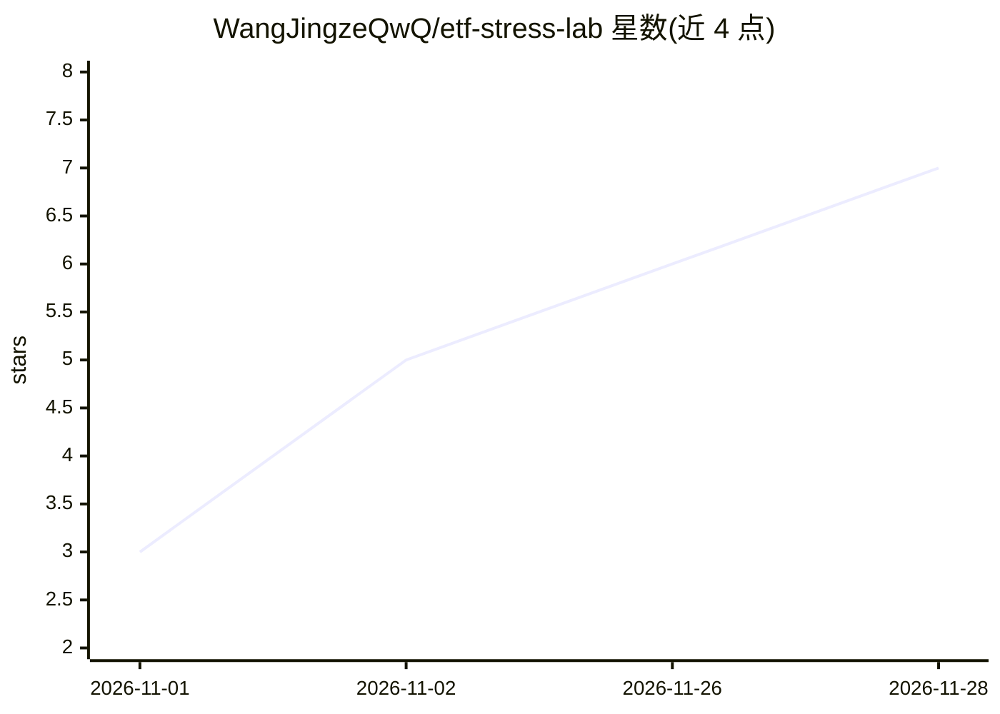

# WangJingzeQwQ/etf-stress-lab

⭐ 7 · Python · MIT · 推送 2026-10-31 · [GitHub](https://github.com/WangJingzeQwQ/etf-stress-lab) · 个人维护 · 中文 README

**可审计的 ETF 杠杆与尾部风险压力测试研究台**

面向量化研究者与 AI 课程项目的序列决策研究平台：每日收盘后对 ETF 候选池排序并决定仓位，比较规则动量、LightGBM、LSTM、标准 PPO 与 CVaR-PPO 等方法。核心机制包括点时化数据（known_at、退市与公司行动）降低幸存者偏差、执行感知回测（T+1、整手、佣金、滑点、利息与合成强平）、purge 后冻结样本外切分与一次性 Holdout 评估。提供 FastAPI + Vue 3 仪表盘做回放展示；明确声明不接入实盘、非投资建议，公开仓库不含约 8.6 GB 行情与派生数据。

## 筛选速览

| 维度 | 判定 | 备注 |
|---|---|---|
| AI 角色 | `ai-native` | 本体是模型或模型工具 |
| 许可风险 | `permissive` | MIT |
| 部署形态 | `desktop` | 安装包/桌面程序 |
| 模型依赖 | — | README 未给出锁定关系 |
| 硬件要求 | — | 无带数字的原话,不猜 |
| 安装摩擦 | `low` | 无编译、无系统依赖或容器化 |
| 成熟度 | `idea` | |

## 能力要点

- 点时化数据层：历史成员、退市、公司行动与 known_at
- AI 消融实验 G1-G6 统一候选池与费用口径，配对 seed
- 执行感知回测：T+1、100 股整手、佣金、滑点、ADV 与合成强平
- 冻结切分与一次性 Holdout，负结果作为交付物

## 适用场景

- 研究高杠杆情景下不同策略的生存稳健性
- 检验 CVaR 惩罚对尾部亏损的作用
- 作为 AI 课程期末设计的消融与统计评估范例

## 场景标签

`金融量化` `强化学习` · 领域:学习与行业

## 证据(README 行号)

> L5: 本项目研究一个受限序列决策问题：每天收盘后，模型从 ETF 候选池中排序并决定仓位；交易过程受手续费、T+1、成交量约束、融资利息和合成强平规则影响。项目比较规则动量、LightGBM、LSTM 表征、标准 PPO、CVaR-PPO
> L23: - **AI 消融实验**：G1-G6 统一候选池、执行和费用口径，使用配对 seed；
> L27: - **交互式展示**：FastAPI + Vue 3 + KLineCharts，支持 validation 回放、时间轴、持仓和压力矩阵。

## 星数曲线

2026-11-01 3 → 2026-11-28 7（+4）

---
*卡片 v1 · prompt 1.4 · 生成 2026-11-21 · 置信度 high · 依据 README sha `1dd680e058b2` · [字段定义](../../DATASET.md)*
