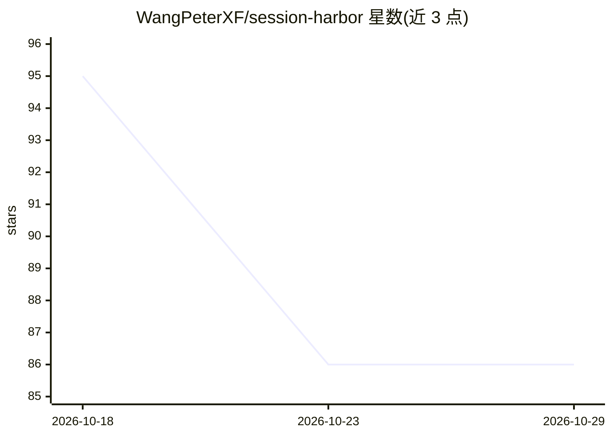

# WangPeterXF/session-harbor

⭐ 86 · JavaScript · NOASSERTION · 推送 2026-08-27 · [GitHub](https://github.com/WangPeterXF/session-harbor) · [官网](https://wangpeterxf.github.io/session-harbor/) · 个人维护 · 中文 README

**本地优先的 Codex 会话备份/清理/恢复/跨设备上下文管理插件**

非官方的 Codex 插件与零依赖 Node.js CLI，把外置硬盘或挂载 NAS 变成经验证的文件系统保险库。提供增量内容寻址备份（SHA-256 读回校验、不可变快照）、受多重门控保护的本地清理、恢复已删除会话，以及 macOS/Windows 设备间的清单互查与经审核的共享上下文。备份与清理为独立决策，命令默认 dry-run，需显式 --apply。不改写 Codex SQLite 与索引文件。许可为 PolyForm Noncommercial，商用需另获书面授权。

## 筛选速览

| 维度 | 判定 | 备注 |
|---|---|---|
| AI 角色 | `ai-ecosystem` | LLM/agent 周边工具 |
| 许可风险 | `none` | NOASSERTION |
| 部署形态 | `None` |  |
| 模型依赖 | — | README 未给出锁定关系 |
| 硬件要求 | — | 无带数字的原话,不猜 |
| 安装摩擦 | `low` | 无编译、无系统依赖或容器化 |
| 成熟度 | `idea` | |

## 能力要点

- 内容寻址增量备份，SHA-256 读回校验与不可变设备专属快照
- 清理前需通过不活跃天数、备份年龄、文件占用与再校验门控
- 跨设备同步只写设备自身目录，本地回收不会传播为跨设备删除
- 备份与清理设置分离，命令默认 dry-run，需 --apply 显式执行

## 适用场景

- 把 Codex 会话备份到外置硬盘或 NAS 并校验完整性
- 安全释放本地磁盘空间且保留可恢复的会话副本
- 在 macOS 与 Windows 两台机器间查看并导出对方的已验证会话

## 场景标签

`Agent 记忆` · 领域:Agent 开发

## 证据(README 行号)

> L13: SessionHarbor is an unofficial, local-first Codex plugin and zero-dependency Node.js CLI by Xiaofan
> L19: |Back up every Codex session|Incremental, content-addressed backup with SHA-256 read-back and immutable device-owne
> L62: SessionHarbor never edits Codex SQLite, `session_index.jsonl`, generated memories, authentication, or

## 星数曲线

2026-10-18 95 → 2026-10-29 86（-9）

---
*卡片 v1 · prompt 1.4 · 生成 2026-10-24 · 置信度 high · 依据 README sha `fb8ee30330ba` · [字段定义](../../DATASET.md)*
