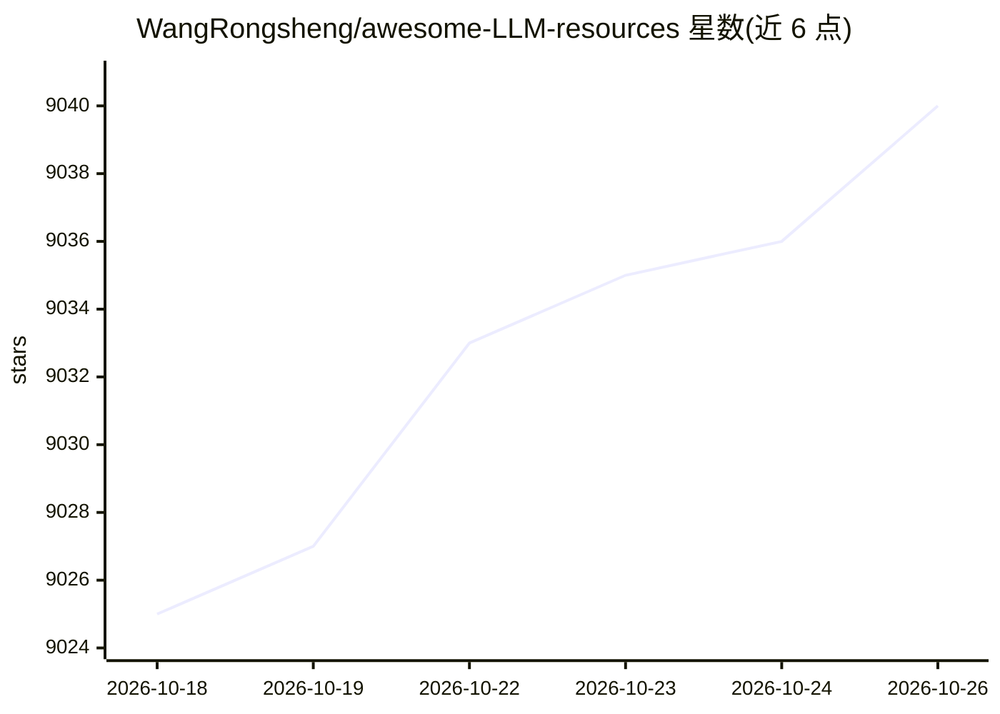

# WangRongsheng/awesome-LLM-resources

⭐ 9,040 · Apache-2.0 · 推送 2026-10-20 · [GitHub](https://github.com/WangRongsheng/awesome-LLM-resources) · 个人维护 · 中文 README

**LLM 学习资源汇总清单：数据、微调、推理、Agent 等**

持续更新的大语言模型资源汇总仓库（awesome-list），按主题收录外部项目与教程链接：数据处理工具（标注、PDF/OCR 提取、合成数据）、微调与训练框架（LLaMA-Factory、unsloth、TRL 等）、Agentic RL 框架、推理工具（ollama、Open WebUI 等），并附播客访谈推荐。条目以'名称+一句描述+链接'形式组织，本身不含代码，不提供安装运行方式；README 含 API 中转服务商赞助内容，另有姊妹项目 Awesome-AI4Med。

## 筛选速览

| 维度 | 判定 | 备注 |
|---|---|---|
| AI 角色 | `ai-knowledge` | 知识聚合/清单类 |
| 许可风险 | `permissive` | Apache-2.0 |
| 部署形态 | `None` |  |
| 模型依赖 | — | README 未给出锁定关系 |
| 硬件要求 | — | 无带数字的原话,不猜 |
| 安装摩擦 | `low` | 无编译、无系统依赖或容器化 |
| 成熟度 | — | 结构信号不足 |

## 能力要点

- 按数据/微调/Agentic RL/推理等主题分类收录 LLM 相关项目
- 数据类目收录 48 个数据处理、OCR、合成数据工具
- 微调类目收录 53 个训练/微调框架与工具
- 附 LLM 领域人物播客访谈清单

## 适用场景

- 查找数据处理、微调、推理各环节的开源工具
- 了解 LLM 训练与 Agent RL 框架的可用选项
- 通过播客清单了解大模型领域人物访谈内容

## 场景标签

`精选清单` · 领域:学习与行业

## 证据(README 行号)

> L1: 全世界最好的大语言模型资源汇总 持续更新
> L55: 1. AotoLabel: Label, clean and enrich text datasets with LLMs.
> L108: 1. LLaMA-Factory (`🔥`): Unify Efficient Fine-Tuning of 100+ LLMs.
> L176: 1. ollama (`🔥`): Get up and running with Llama 3, Mistral, Gemma, and other large language models.

## 星数曲线

2026-10-18 9,025 → 2026-10-26 9,040（+15）

---
*卡片 v1 · prompt 1.4 · 生成 2026-10-20 · 置信度 high · 依据 README sha `7c7c5cbe65c8` · [字段定义](../../DATASET.md)*
