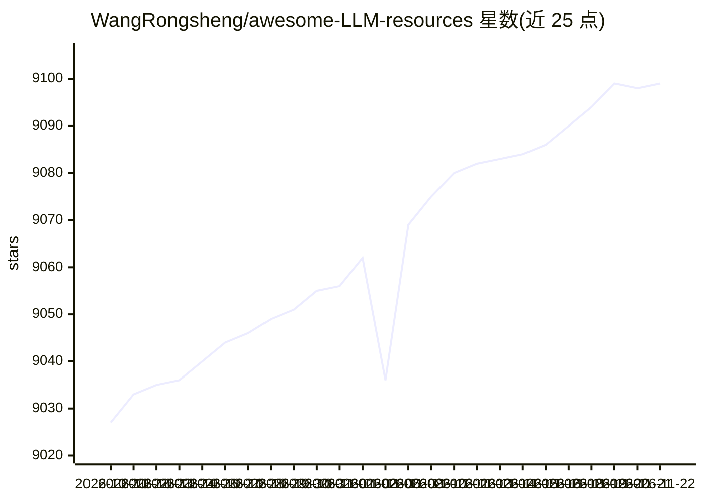

# WangRongsheng/awesome-LLM-resources

⭐ 9,099 · Apache-2.0 · 推送 2026-11-21 · [GitHub](https://github.com/WangRongsheng/awesome-LLM-resources) · 个人维护 · 中文 README

**大语言模型学习与开发资源的聚合清单，面向 LLM 从业者**

持续更新的大语言模型资源汇总清单，按主题分节收录项目条目，覆盖数据处理、微调、Agentic RL、推理等方向；每个条目附一句话简介与 GitHub 链接，部分以 🔥 标记。条目形式为外部仓库链接的罗列，不含本产品的安装或运行说明。维护者另维护医疗方向的 Awesome-AI4Med 清单，并附相关播客访谈推荐。

## 筛选速览

| 维度 | 判定 | 备注 |
|---|---|---|
| AI 角色 | `ai-knowledge` | 知识聚合/清单类 |
| 许可风险 | `permissive` | Apache-2.0 |
| 部署形态 | `None` |  |
| 模型依赖 | — | README 未给出锁定关系 |
| 硬件要求 | — | 无带数字的原话,不猜 |
| 安装摩擦 | `low` | 无编译、无系统依赖或容器化 |
| 成熟度 | — | 结构信号不足 |

## 能力要点

- 按数据、微调、Agentic RL、推理等主题分节的条目组织
- 收录数据处理（OCR/解析/合成数据）、微调框架、推理运行时等多类资源
- 条目附一句话简介与仓库链接，🔥 标记部分条目
- 配套推荐播客访谈清单

## 适用场景

- 查找 LLM 数据处理与微调相关工具的入口
- 按主题浏览推理部署和 WebUI 类项目
- 关注 LLM 领域访谈与播客内容

## 场景标签

`精选清单` · 领域:学习与行业

## 证据(README 行号)

> L1: 全世界最好的大语言模型资源汇总 持续更新
> L12: #### 目录
> L35: ## 数据 Data

## 星数曲线

2026-10-20 9,027 → 2026-11-22 9,099（+72）

---
*卡片 v1 · prompt 1.4 · 生成 2026-11-22 · 置信度 high · 依据 README sha `33492464b7b0` · [字段定义](../../DATASET.md)*
