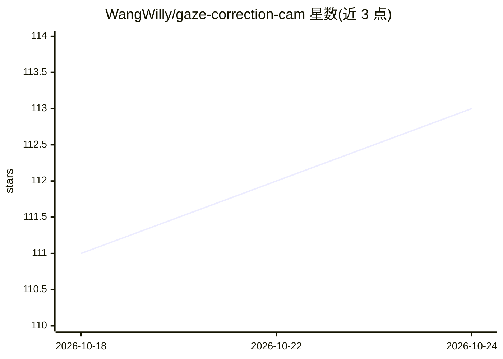

# WangWilly/gaze-correction-cam

⭐ 113 · Python · BSD-3-Clause · 推送 2026-03-12 · [GitHub](https://github.com/WangWilly/gaze-correction-cam) · 个人维护

**macOS 虚拟摄像头：实时校正视线，让视频通话保持眼神接触**

macOS 虚拟摄像头扩展应用，实时捕获摄像头画面，检测人脸与眼部位置，通过神经网络 warp 模型重定向视线方向，并以虚拟摄像头设备输出校正后画面，可在 Zoom、Teams、FaceTime 等视频应用中选用。提供下载即用的 .app 安装方式，也支持从源码构建 Python CLI（需 Python 3.12+、Poetry、CMake、pkg-config，并下载 dlib 68 点地标与 warp 模型权重）。含快捷键开关与校准面板（相机位置、距离、焦距），仅支持 macOS 14 及以上。

## 筛选速览

| 维度 | 判定 | 备注 |
|---|---|---|
| AI 角色 | `ai-native` | 本体是模型或模型工具 |
| 许可风险 | `permissive` | BSD-3-Clause |
| 部署形态 | `None` |  |
| 模型依赖 | — | README 未给出锁定关系 |
| 硬件要求 | — | 无带数字的原话,不猜 |
| 安装摩擦 | `low` | 无编译、无系统依赖或容器化 |
| 成熟度 | — | 结构信号不足 |

## 能力要点

- 实时人脸/眼部检测加神经网络 warp 的视线重定向
- 以虚拟摄像头设备输出，兼容 Zoom/Teams/FaceTime 等视频应用
- 提供 g/c/q 快捷键与相机位置、距离、焦距校准面板
- 支持 dlib 默认后端与可选 MediaPipe 后端

## 适用场景

- 视频通话时看笔记或自己画面也能保持眼神接触
- 直播或录制时校正视线朝向镜头
- 开发者从源码运行 Python CLI 进行定制或调试

## 场景标签

`图像视频处理` · 领域:感知与多模态

## 证据(README 行号)

> L94: 4. Applies a learned neural network warp to redirect your gaze
> L5: Gaze Correction Camera is a macOS virtual camera extension that automatically adjusts your eye direction in real-tim

## 星数曲线

2026-10-18 111 → 2026-10-24 113（+2）

---
*卡片 v1 · prompt 1.4 · 生成 2026-10-23 · 置信度 high · 依据 README sha `6ca776b40b8c` · [字段定义](../../DATASET.md)*
