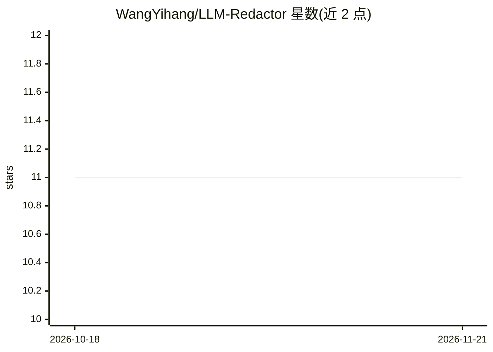

# WangYihang/LLM-Redactor

⭐ 11 · Go · 推送 2026-03-13 · [GitHub](https://github.com/WangYihang/LLM-Redactor) · 个人维护 · 中文 README

**本地透明代理：在敏感凭据离开机器前为 LLM 编码代理脱敏**

以透明出口网关形式运行的本地代理：在 LLM 编码代理（如 claude、gemini、codex）的请求发往云端前，基于 Gitleaks 兼容规则检测 100+ 种密钥类型并本地替换为占位符，支持 SSE 流实时过滤与嵌套 JSON 递归扫描，检测到的泄露记录到 detections.jsonl 供事后审计。提供两种使用方式：在原命令前前置 llm-redactor-exec 自动配置代理与环境变量，或以独立代理服务运行并设置 HTTP(S)_PROXY。无需修改现有工作流配置。

## 筛选速览

| 维度 | 判定 | 备注 |
|---|---|---|
| AI 角色 | `ai-ecosystem` | LLM/agent 周边工具 |
| 许可风险 | `none` | — |
| 部署形态 | `library` | 以包/库形式分发 |
| 模型依赖 | — | README 未给出锁定关系 |
| 硬件要求 | — | 无带数字的原话,不猜 |
| 安装摩擦 | `low` | 无编译、无系统依赖或容器化 |
| 成熟度 | — | 结构信号不足 |

## 能力要点

- 基于 Gitleaks 兼容规则自动检测 100+ 种密钥类型并本地脱敏
- SSE 流实时过滤，宣称零延迟
- 递归扫描嵌套 JSON 结构（如 Anthropic content blocks）
- 泄露记录写入 detections.jsonl 并输出会话审计摘要

## 适用场景

- 使用云端 LLM 编码 CLI 时防止 API key 与 PII 上传
- 为多个工具或后台进程运行常驻脱敏代理
- 会话结束后审计本地曾出现哪些密钥泄露

## 场景标签

`网络安全` · 领域:学习与行业

## 证据(README 行号)

> L3: A local transparent proxy to redact secrets (API keys, PII) before they leave your machine.
> L13: - Automatic Redaction: Detects 100+ secret types using Gitleaks-compatible rules.
> L21: This is the easiest way to use LLM-Redactor. Just prepend the command to your existing CLI tool. It will automatica

## 星数曲线

2026-10-18 11 → 2026-11-21 11（+0）

---
*卡片 v1 · prompt 1.4 · 生成 2026-11-18 · 置信度 high · 依据 README sha `59763f46aa91` · [字段定义](../../DATASET.md)*
