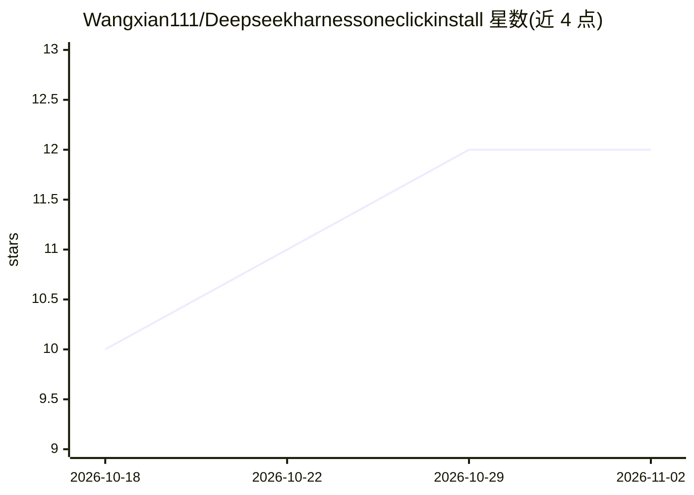

# Wangxian111/Deepseekharnessoneclickinstall

⭐ 12 · PowerShell · 推送 2026-08-16 · [GitHub](https://github.com/Wangxian111/Deepseekharnessoneclickinstall) · 个人维护 · 中文 README

**Windows 用户一键安装 DeepSeek Harness 的便携安装器**

面向 Windows 用户的 DeepSeek Harness（dsh）一键安装工具：把官方的 px 安装方式封装为双击 .cmd 的安装流程，自动下载便携版 Node.js、通过 npmmirror/华为云国内镜像安装 @deepseek-ai/dsh，并提供本地网页控制面板完成安装/启动/更新/卸载。不写注册表、不改环境变量，删除目录即卸载。需自行配置 DeepSeek API Key。仅限 Windows，依赖国内镜像解决网络不稳问题。

## 筛选速览

| 维度 | 判定 | 备注 |
|---|---|---|
| AI 角色 | `ai-ecosystem` | LLM/agent 周边工具 |
| 许可风险 | `none` | — |
| 部署形态 | `None` |  |
| 模型依赖 | locked-api |  |
| 硬件要求 | — | 无带数字的原话,不猜 |
| 安装摩擦 | `low` | 无编译、无系统依赖或容器化 |
| 成熟度 | — | 结构信号不足 |

## 能力要点

- 双击 .cmd 一键安装 DeepSeek Harness，免管理员权限
- 自动下载便携版 Node.js，无需预装 Node/Python/Git
- npmmirror/华为云国内镜像自动切换
- 本地网页控制面板（默认 127.0.0.1:3080）覆盖安装/启动/更新/卸载

## 适用场景

- 国内网络环境下安装 DeepSeek Harness 官方框架失败时的替代途径
- 在 Windows 上免安装、免管理员权限地部署 dsh
- 通过图形面板管理 dsh 的启动、更新与卸载

## 场景标签

 · 领域:AI 工具/安装部署

## 证据(README 行号)

> L6: **DeepSeek Harness** 是 DeepSeek 官方开源的智能体框架（Model + Harness = Agent，一切皆插件）。官方安装方式
> L7: px @deepseek-ai/dsh web 在国内网络环境下容易失败，本工具把它封装成 **Windows 一键安装 + 启动**，适合网络不稳定与免安装诉求。

## 星数曲线

2026-10-18 10 → 2026-11-02 12（+2）

---
*卡片 v1 · prompt 1.4 · 生成 2026-11-01 · 置信度 high · 依据 README sha `1ecbfe6fc087` · [字段定义](../../DATASET.md)*
