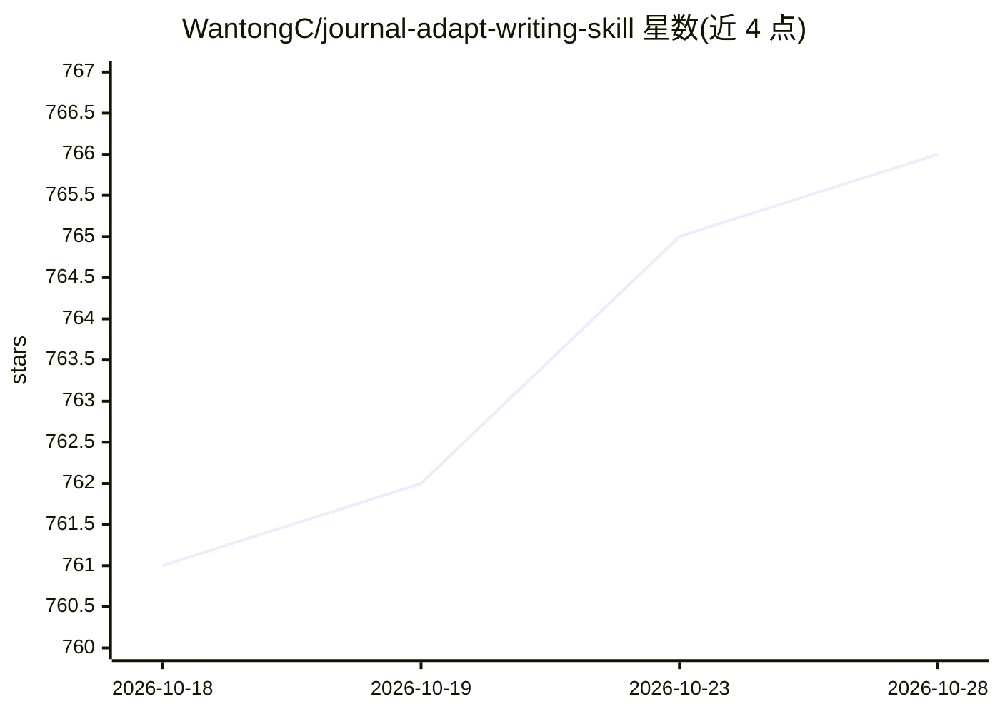

# WantongC/journal-adapt-writing-skill

⭐ 767 · MIT · 推送 2026-05-15 · [GitHub](https://github.com/WantongC/journal-adapt-writing-skill) · 个人维护

**从目标期刊论文语料学习写作规范并逐节修改稿件的 agent 技能**

面向 Claude Code / Codex 的学术写作技能框架：以目标期刊已发表论文为主语料（辅以领域顶刊与作者范文），生成针对单一稿件与目标期刊的动态写作技能 dynamic_writing_skill.md 与风格画像，再由 agent 按五级优先级（事实安全 > 期刊语料 > 补充语料 > 静态规则 > 清理规则）逐节修改稿件。静态技能层可选，可接入五个开源写作技能或自带指南。输出为 Markdown 修订文件与修订日志，需人工复核；仅支持英文学术写作，不新增事实与引用，不引用受版权语料原文。

## 筛选速览

| 维度 | 判定 | 备注 |
|---|---|---|
| AI 角色 | `ai-ecosystem` | LLM/agent 周边工具 |
| 许可风险 | `permissive` | MIT |
| 部署形态 | `None` |  |
| 模型依赖 | locked-api |  |
| 硬件要求 | — | 无带数字的原话,不猜 |
| 安装摩擦 | `low` | 无编译、无系统依赖或容器化 |
| 成熟度 | — | 结构信号不足 |

## 能力要点

- 从目标期刊论文语料生成单一稿件专属的动态写作技能
- 五级优先级体系，P1 硬约束保护事实、引用、公式与数字结果
- 可选静态技能层，收录 5 个开源学术写作技能与自定义指南
- 主语料建议 5-8 篇期刊论文，输出修订日志可审计

## 适用场景

- 投稿前让 agent 按目标期刊的行文结构逐节修改我的稿件
- 保留导师/实验室写作偏好的同时适配期刊风格
- 清理 AI 腔调措辞与空洞过渡句

## 场景标签

`提示工程` `AI 写作` · 领域:Agent 开发

## 证据(README 行号)

> L3: > **A static + dynamic academic writing skill framework. Start with reusable writing rules, then generate a corpus-g
> L96: mkdir -p ~/.claude/skills/journal-adapt

## 星数曲线

2026-10-18 761 → 2026-10-28 766（+5）

---
*卡片 v1 · prompt 1.4 · 生成 2026-10-22 · 置信度 high · 依据 README sha `4efb15ce4cc1` · [字段定义](../../DATASET.md)*
