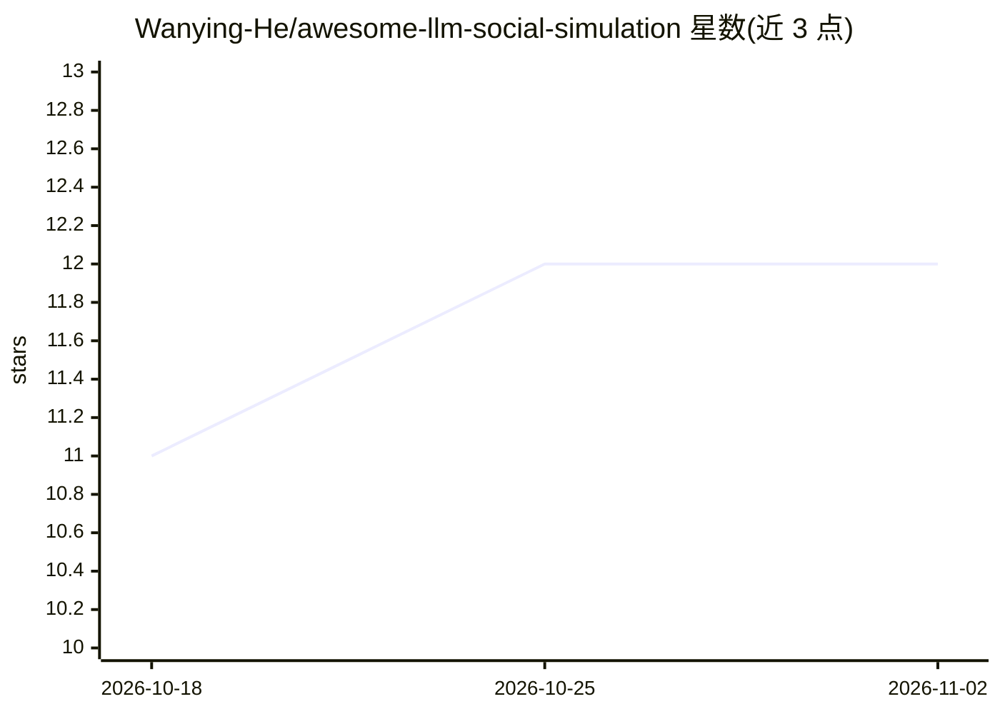

# Wanying-He/awesome-llm-social-simulation

⭐ 12 · MIT · 推送 2026-02-27 · [GitHub](https://github.com/Wanying-He/awesome-llm-social-simulation) · 个人维护

**LLM 社会模拟研究的注释性论文阅读清单**

由个人维护的 curated awesome list，收录 LLM 驱动的社会模拟研究文献与平台。内容按综述与立场论文、通用与混合模拟平台、社会网络模拟器、评测基准、领域应用组织；每条目带 survey/critique/platform/benchmark/validated/agent 规模等标签与一句话注解，标注代码可得性。覆盖 Stanford Generative Agents、OASIS、AgentSociety 等平台及验证方法论批判文献。仅是阅读清单，不提供可运行软件，更新至 2026 年 2 月。

## 筛选速览

| 维度 | 判定 | 备注 |
|---|---|---|
| AI 角色 | `ai-knowledge` | 知识聚合/清单类 |
| 许可风险 | `permissive` | MIT |
| 部署形态 | `None` |  |
| 模型依赖 | — | README 未给出锁定关系 |
| 硬件要求 | — | 无带数字的原话,不猜 |
| 安装摩擦 | `low` | 无编译、无系统依赖或容器化 |
| 成熟度 | — | 结构信号不足 |

## 能力要点

- 按综述/平台/基准/应用等类别组织文献条目
- 条目带 survey/critique/validated/规模等标注标签与注解
- 收录平台表格含机构、日期、agent 规模与代码链接列
- 专设验证方法论批判与评测基准板块

## 适用场景

- 快速了解 LLM 社会模拟领域的研究脉络与关键论文
- 按平台/基准/应用类别查找可用工具与数据集
- 追踪领域对验证与行为保真度的批判性讨论

## 场景标签

`精选清单` `科研工具` · 领域:学习与行业

## 证据(README 行号)

> L1: # Awesome LLM Social Simulation
> L3: > A curated and annotated reading list for LLM-based social simulation research.

## 星数曲线

2026-10-18 11 → 2026-11-02 12（+1）

---
*卡片 v1 · prompt 1.4 · 生成 2026-11-01 · 置信度 high · 依据 README sha `06974f7aef8e` · [字段定义](../../DATASET.md)*
