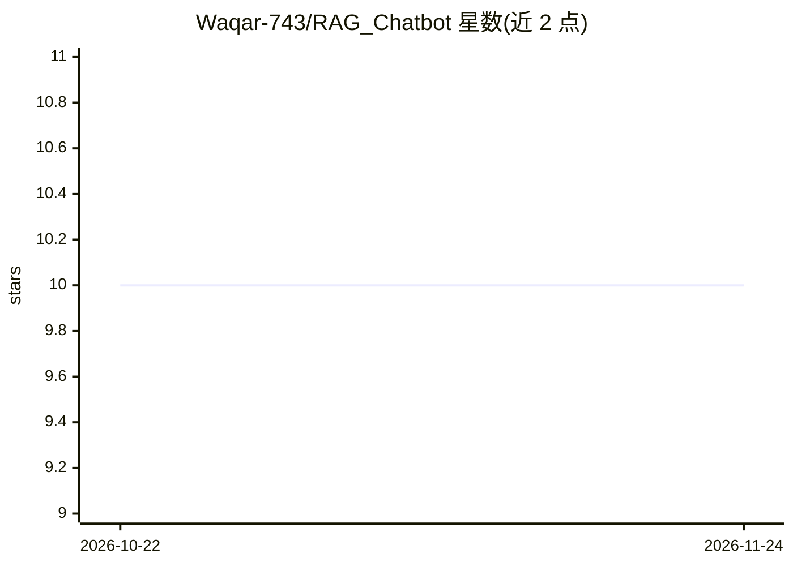

# Waqar-743/RAG_Chatbot

⭐ 10 · Python · 推送 2026-07-16 · [GitHub](https://github.com/Waqar-743/RAG_Chatbot) · [官网](https://rag-chatbot-waqar.onrender.com) · 个人维护

**面向开发者的带引用溯源的 RAG 文档问答应用**

Ragnarok 是一个生产部署形态的文档问答系统：将用户上传的 PDF/DOCX/Markdown/纯文本或网页 URL 清洗分块，通过 OpenRouter 生成嵌入并存入 Qdrant 向量库；提问时检索最相关证据片段，由语言模型基于证据生成回答并附带来源与相似度分数，证据不足时拒答。后端 FastAPI、前端 React/Vite，聊天历史与元数据可选存入 MongoDB Atlas；提供 Render 一键部署与本地运行脚本。

## 筛选速览

| 维度 | 判定 | 备注 |
|---|---|---|
| AI 角色 | `ai-native` | 本体是模型或模型工具 |
| 许可风险 | `none` | — |
| 部署形态 | `library` | 以包/库形式分发 |
| 模型依赖 | locked-api |  |
| 硬件要求 | — | 无带数字的原话,不猜 |
| 安装摩擦 | `low` | 无编译、无系统依赖或容器化 |
| 成熟度 | — | 结构信号不足 |

## 能力要点

- 回答附带来源片段与相似度分数，证据不足时明确拒答
- 支持 PDF、DOCX、Markdown、纯文本与网页 URL 索引
- OpenRouter 提供嵌入与聊天补全，Qdrant 存储向量
- Render Blueprint 一键部署，前后端分离可替换

## 适用场景

- 面向内部文档或支持知识库搭建带出处的问答
- 对研究论文提问并查看结论对应的原文出处
- 将课程资料或个人笔记变为可自然语言检索的知识库

## 场景标签

`文档问答` `RAG` · 领域:知识与检索

## 证据(README 行号)

> L7: Give it a document, a URL, or a collection of notes. Ragnarok breaks that knowledge into searchable pieces, stores t
> L24: 6. The language model writes an answer from that evidence and returns the sources beside it.
> L54: |Language intelligence|OpenRouter|Provides embeddings and chat completion|

## 星数曲线

2026-10-22 10 → 2026-11-24 10（+0）

---
*卡片 v1 · prompt 1.4 · 生成 2026-11-20 · 置信度 high · 依据 README sha `cb88df390b6f` · [字段定义](../../DATASET.md)*
