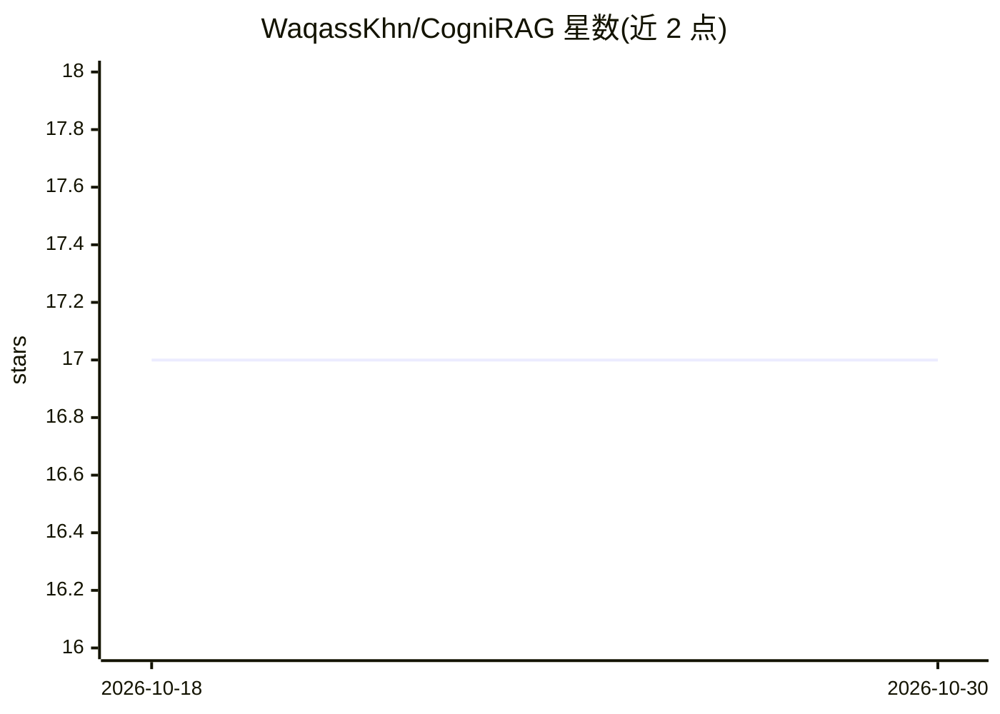

# WaqassKhn/CogniRAG

⭐ 17 · Python · 推送 2026-09-19 · [GitHub](https://github.com/WaqassKhn/CogniRAG) · 个人维护

**面向企业文档的混合检索 RAG 问答助手（向量+BM25+知识图谱）**

文档接地型企业问答应用：上传 PDF/DOCX/CSV 等文档后，经双摄入管线同步写入 Pinecone 向量索引与 Neo4j 知识图谱；查询时由 Agent 策略路由器在 dense、dense_bm25、graph_only、hybrid 四种检索管线间选择，再用三路 RRF 融合排序，回答附带片段引用与多跳关系路径。带 token 级接地审计、四层认知记忆、PyVis 图谱可视化和 SQLite 持久化。全栈基于免费额度（Pinecone Free、OpenRouter :free 模型、本地 MiniLM 嵌入、Docker Neo4j），需 Pinecone 与 OpenRouter API key；Docker/Neo4j 离线时降级为向量+BM25 模式。以 Streamlit 应用形式通过 Docker Compose 或本地 Python 环境运行。

## 筛选速览

| 维度 | 判定 | 备注 |
|---|---|---|
| AI 角色 | `ai-native` | 本体是模型或模型工具 |
| 许可风险 | `none` | — |
| 部署形态 | `self-host` | docker 或自建部署 |
| 模型依赖 | locked-api |  |
| 硬件要求 | — | 无带数字的原话,不猜 |
| 安装摩擦 | `low` | 无编译、无系统依赖或容器化 |
| 成熟度 | — | 结构信号不足 |

## 能力要点

- Pinecone 稠密向量 + BM25 稀疏 + Neo4j 多跳图遍历的混合检索，三路 RRF 融合
- Agent 策略路由在 4 种检索管线间动态选择，支持手动覆盖
- token 级接地审计与数值准确性校验（DocumentGroundingEvaluator）
- 四层认知记忆（Working/Episodic/Semantic/Procedural）与 SQLite 会话持久化
- 全零成本架构：免费层 Pinecone、OpenRouter :free 模型级联回退、本地嵌入

## 适用场景

- 上传企业制度/报告文档并做带引用溯源的问答
- 跨政策、角色、部门的多元关系多跳图查询与可视化
- 在不付费的前提下搭建企业文档智能助手
- 对回答做接地审计以核验有据可依

## 场景标签

`RAG` `文档问答` · 领域:知识与检索

## 证据(README 行号)

> L16: CogniRAG is a production-grade, document-grounded enterprise intelligence assistant featuring **Dual-Engine Hybrid 
> L31: |**Agentic Strategy Routing**|`QueryPlannerAgent`|🟢 Active|Dynamically routes queries to retrieval modes; supports 
> L147: 1. **Chat Tab (`Chat`)**:

## 星数曲线

2026-10-18 17 → 2026-10-30 17（+0）

---
*卡片 v1 · prompt 1.4 · 生成 2026-10-29 · 置信度 mid · 依据 README sha `fb5869ad9bb8` · [字段定义](../../DATASET.md)*
