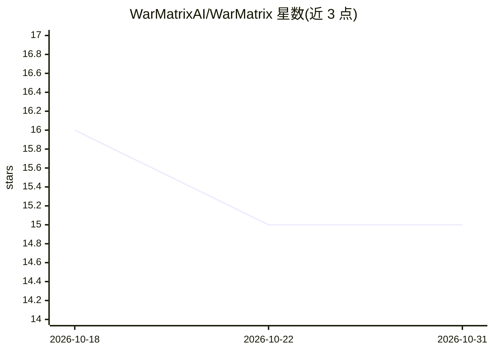

# WarMatrixAI/WarMatrix

⭐ 15 · TypeScript · AGPL-3.0 · 推送 2026-08-03 · [GitHub](https://github.com/WarMatrixAI/WarMatrix) · [官网](https://war-matrix.vercel.app) · 组织维护 · 中文 README

**面向指挥官的 3D 战术仿真与指挥控制台，AI 生成简报与场景**

战术仿真与指挥控制台应用：前端 Next.js 15/React 19 + Three.js 提供 2D 战略图、3D 战术图与命令控制台；后端 FastAPI + Python 仿真引擎处理机动成功率、战斗损耗与目标控制。AI 集成层（ai_server/）支持本地或云端 LLM（如 Qwen、Llama、Gemini），用于按用户参数动态生成场景、将仿真数据转为叙事简报及预测敌方行为。用户通过自然语言下发命令，任务结束后生成含伤亡与效率分析的复盘报告。部署依赖 npm 与多个服务组件。

## 筛选速览

| 维度 | 判定 | 备注 |
|---|---|---|
| AI 角色 | `ai-enhanced` | 去掉 AI 部分产品仍成立 |
| 许可风险 | `viral` | AGPL-3.0 |
| 部署形态 | `library` | 以包/库形式分发 |
| 模型依赖 | — | README 未给出锁定关系 |
| 硬件要求 | — | 无带数字的原话,不猜 |
| 安装摩擦 | `medium` | 含编译或系统依赖之一 |
| 成熟度 | — | 结构信号不足 |

## 能力要点

- Three.js 3D 战术图 + 自然语言命令下发（FastAPI 仿真引擎解析）
- AI 集成层支持本地（Qwen/Llama）与云端（Gemini）LLM
- 场景生成、军事简报叙事化与敌方行为预测三项 AI 功能
- 任务后生成伤亡、装备损耗与弹药消耗的复盘报告

## 适用场景

- 以自然语言指挥部队进行陆海空战术仿真推演
- 利用 AI 按地形/天气/兵力部署参数生成作战场景与简报
- 任务结束后查看效率分析与 AI 战术评价的复盘报告

## 场景标签

`AI 写作` · 领域:内容生成

## 证据(README 行号)

> L72: - **Engine:** Hybrid AI Backend (`ai_server/`) supporting local and cloud-based LLMs.
> L73: - **Model Layer:** Fine-tuned local models (e.g. Qwen, Llama) or Cloud APIs (e.g. Gemini).
> L75:  - Dynamic scenario generation based on user parameters.

## 星数曲线

2026-10-18 16 → 2026-10-31 15（-1）

---
*卡片 v1 · prompt 1.4 · 生成 2026-10-30 · 置信度 mid · 依据 README sha `2f2b677164d8` · [字段定义](../../DATASET.md)*
