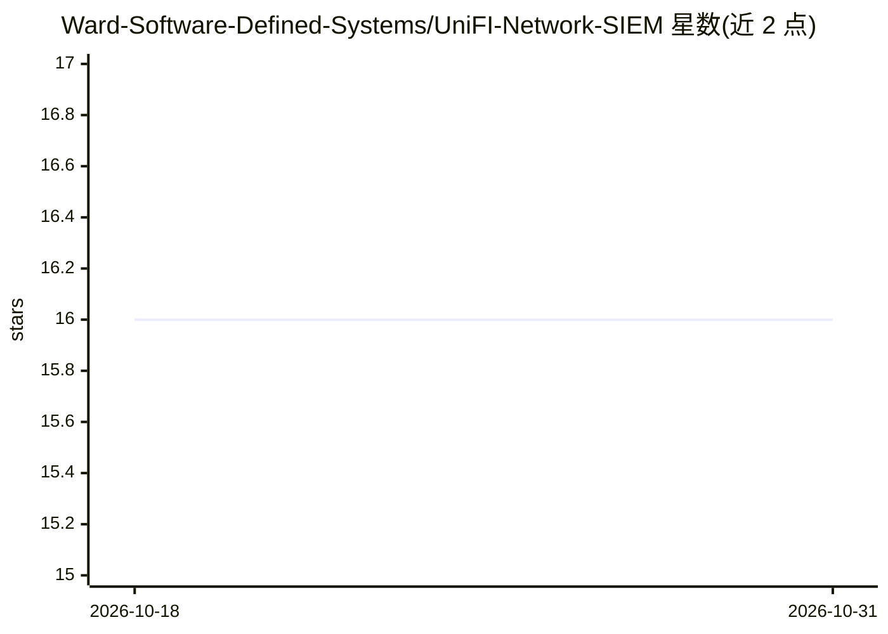

# Ward-Software-Defined-Systems/UniFI-Network-SIEM

⭐ 16 · JavaScript · Apache-2.0 · 推送 2026-10-09 · [GitHub](https://github.com/Ward-Software-Defined-Systems/UniFI-Network-SIEM) · [官网](https://www.wsds.io) · 组织维护

**自托管 UniFi 网络的 SIEM：日志采集、仪表盘与 AI 威胁狩猎**

单进程 Node.js 应用：通过 UDP 收集 UniFi 控制台与网关的 syslog/CEF 日志，用 11 类解析器（防火墙、威胁、DHCP、DNS、Wi-Fi、VPN 等）解析，存入 SQLite（默认）或 OpenSearch/WardSONDB（Beta），提供实时事件流、统计仪表盘、Leaflet 世界地图、GeoIP 与 AbuseIPDB 富化及威胁情报表。AI 部分为 Threat Hunt（Beta）：输入 IP 后汇总本地 SIEM 活动与外部情报（rDNS/WHOIS/ASN），以 SSE 流式输出结构化 AI 威胁评估并支持 PDF 导出，可接 Anthropic/OpenAI/Google API key（README 注明仅 Anthropic 经测试）。需 Node.js v22 与 C++ 构建工具链（better-sqlite3 原生编译）。

## 筛选速览

| 维度 | 判定 | 备注 |
|---|---|---|
| AI 角色 | `ai-enhanced` | 去掉 AI 部分产品仍成立 |
| 许可风险 | `permissive` | Apache-2.0 |
| 部署形态 | `library` | 以包/库形式分发 |
| 模型依赖 | — | README 未给出锁定关系 |
| 硬件要求 | — | 无带数字的原话,不猜 |
| 安装摩擦 | `medium` | 含编译或系统依赖之一 |
| 成熟度 | `idea` | |

## 能力要点

- UDP syslog 采集 + 11 类事件解析器，自动识别格式
- SQLite 物化汇总表（实测 800 万+ 事件）与可选 OpenSearch/WardSONDB 后端
- GeoIP/AbuseIPDB 富化、实时地图与威胁情报表
- AI Threat Hunt（Beta）：SSE 流式输出 AI 威胁评估，支持 PDF 导出

## 适用场景

- 给家里的 UniFi 网络配一个自托管安全监控面板
- 事后排查可疑 IP 的完整画像与 AI 分析
- 长期留存并统计防火墙/IDS/DHCP 等网络事件

## 场景标签

`网络安全` · 领域:学习与行业

## 证据(README 行号)

> L7: A self-contained, **AI-powered** Node.js application that collects syslog from UniFi consoles and gateways, parses a
> L24: - **Threat Hunt (Beta)** — AI-powered threat actor investigation with SSE streaming. Enter any IP and choose a time

## 星数曲线

2026-10-18 16 → 2026-10-31 16（+0）

---
*卡片 v1 · prompt 1.4 · 生成 2026-10-30 · 置信度 high · 依据 README sha `3a175bc16db0` · [字段定义](../../DATASET.md)*
