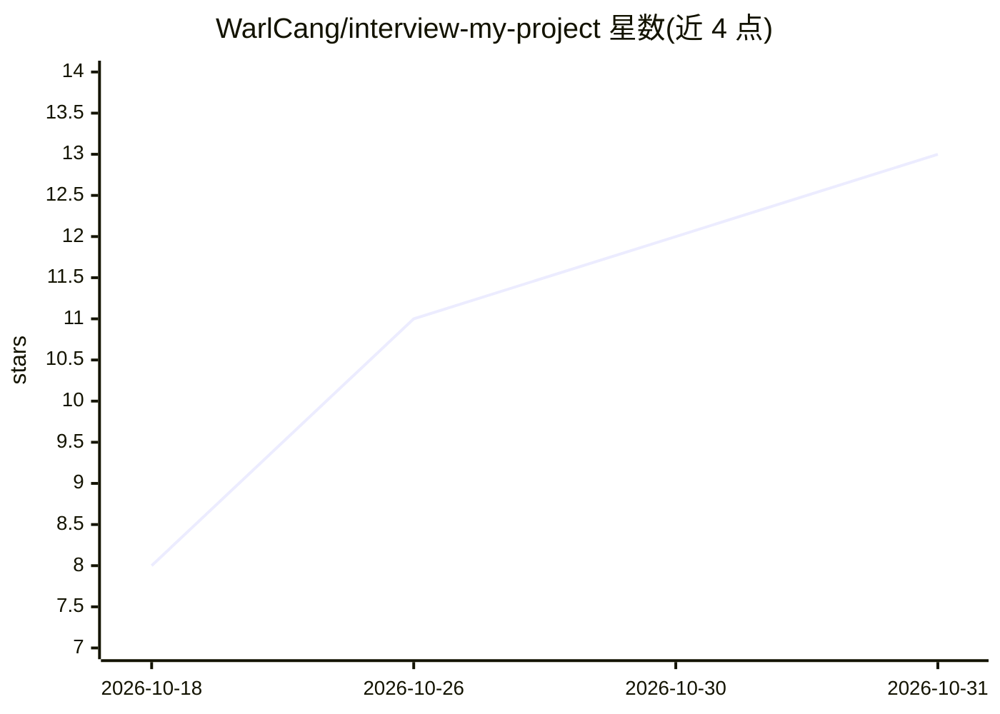

# WarlCang/interview-my-project

⭐ 13 · JavaScript · MIT · 推送 2026-09-04 · [GitHub](https://github.com/WarlCang/interview-my-project) · 个人维护 · 中文 README

**针对你自己项目的 AI 模拟面试：读代码库与 agent 会话日志来拷问你**

以 Agent Skills 格式分发的面试技能包：安装到 Claude Code、Cursor、Codex、Copilot、DeepSeek 等任意 agent 后，读取目标仓库结构与本地 ~/.claude/projects/ 会话日志，生成追问式问题库并逐题面试，给出 🟢/🟡/🔴 评分、file:line 证据的复盘与改进清单，并以 .interview/scorecard.json 跟踪跨次会话的准备度趋势。支持 quick/deep/focus/role 四种模式与任意语言。仓库、日志与评分卡均留在本地，无遥测与网络调用；无会话日志时降级为仅基于仓库的面试。

## 筛选速览

| 维度 | 判定 | 备注 |
|---|---|---|
| AI 角色 | `ai-native` | 本体是模型或模型工具 |
| 许可风险 | `permissive` | MIT |
| 部署形态 | `library` | 以包/库形式分发 |
| 模型依赖 | — | README 未给出锁定关系 |
| 硬件要求 | — | 无带数字的原话,不猜 |
| 安装摩擦 | `low` | 无编译、无系统依赖或容器化 |
| 成熟度 | — | 结构信号不足 |

## 能力要点

- 读取仓库与本地 agent 会话日志（自动发现 Claude Code/Codex 日志）生成问题库
- 逐题追问并给出 🟢/🟡/🔴 评分与 file:line 证据复盘（Say/Avoid/Fix）
- quick/deep/focus/role 多模式，可按 PM/设计/数据/工程岗位校准
- 支持任意语言（含中文），数据全部本地，无遥测

## 适用场景

- 面试前针对自己作品集项目做模拟技术面
- AI 代写的项目要验证自己是否真正理解每个决策
- 按不同岗位（PM/设计/数据/工程）练习'讲讲你的项目'

## 场景标签

 · 领域:开发者工具/面试准备

## 证据(README 行号)

> L9: An AI interviewer for **your** repo. It reads your codebase *and* your Claude Code
> L102: 1. **Ingest** — scans your repo structure and key decisions, then mines your local
> L109:  pushes when you hand-wave, honest scoring: 🟢 solid / 🟡 shaky / 🔴 couldn't defend.

## 星数曲线

2026-10-18 8 → 2026-10-31 13（+5）

---
*卡片 v1 · prompt 1.4 · 生成 2026-10-31 · 置信度 high · 依据 README sha `2e536e5886e3` · [字段定义](../../DATASET.md)*
