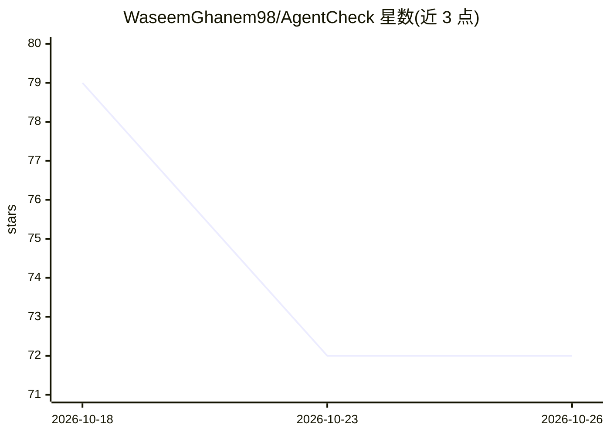

# WaseemGhanem98/AgentCheck

⭐ 72 · Python · Apache-2.0 · 推送 2026-10-01 · [GitHub](https://github.com/WaseemGhanem98/AgentCheck) · 个人维护

**面向开发者的 AI agent 行为测试与 CI 门禁框架**

Python 测试框架：针对 AI agent 的执行行为而非最终回答质量做评估，检查工具调用顺序、确认、重试、失败处理与策略约束等行为契约。工作流为 inspect/generate/test 四命令，generate 生成冻结测试套件（含工具出错、超时、截断等故障用例），test 时声明的真实工具处理器不执行、由 fixture 模拟结果，未知工具与缺失 fixture 均以 fail-closed 处理。提供 gate 命令与可信基线比较，输出 0-3 四级退出码用于 CI 门禁。支持 OpenAI Agents SDK（限 0.20-0.22）、PydanticAI 与自定义 Python agent 三种集成；快速入门可完全离线、无需模型 key。

## 筛选速览

| 维度 | 判定 | 备注 |
|---|---|---|
| AI 角色 | `ai-ecosystem` | LLM/agent 周边工具 |
| 许可风险 | `permissive` | Apache-2.0 |
| 部署形态 | `library` | 以包/库形式分发 |
| 模型依赖 | — | README 未给出锁定关系 |
| 硬件要求 | — | 无带数字的原话,不猜 |
| 安装摩擦 | `low` | 无编译、无系统依赖或容器化 |
| 成熟度 | — | 结构信号不足 |

## 能力要点

- 四命令工作流：inspect/generate/test/gate，生成冻结行为测试套件
- 故障注入用例：工具报错、超时、空/截断/过期返回
- 声明工具在评估中不真实执行，fixture 模拟且 fail-closed
- CI gate 对比可信基线，输出 PASS/FAIL/INCONCLUSIVE/INFRA_ERROR 四级裁决

## 适用场景

- 在 CI 中对 agent 发布做行为回归门禁
- 检测未确认的破坏性操作、失败后伪造成功、不安全重试等行为
- 为 OpenAI Agents SDK / PydanticAI agent 生成并运行行为测试套件

## 场景标签

`模型评测` · 领域:评测与运维

## 证据(README 行号)

> L9: You already test your code. AgentCheck tests the decisions your agent makes.
> L169: Normal tests ask whether a function returned the expected value. AgentCheck asks
> L80: agentcheck gate .

## 星数曲线

2026-10-18 79 → 2026-10-26 72（-7）

---
*卡片 v1 · prompt 1.4 · 生成 2026-10-24 · 置信度 high · 依据 README sha `2540f7643f5d` · [字段定义](../../DATASET.md)*
