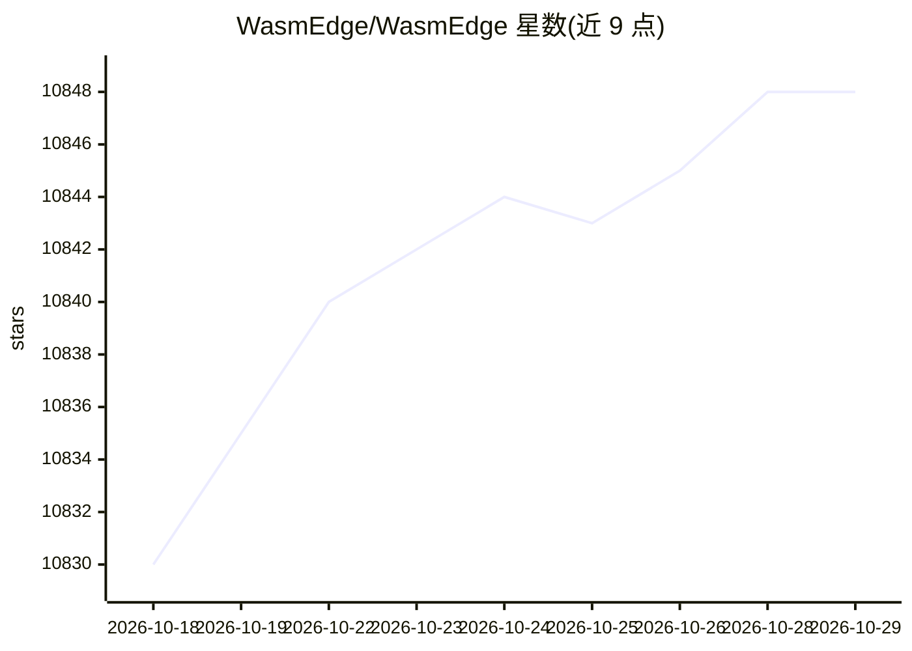

# WasmEdge/WasmEdge

⭐ 10,848 · C++ · Apache-2.0 · 推送 2026-10-28 · [GitHub](https://github.com/WasmEdge/WasmEdge) · [官网](https://WasmEdge.org) · 组织维护

**轻量 WebAssembly 运行时：在服务器/边缘/设备上沙箱化运行 Wasm 与 GenAI 应用**

CNCF 官方沙箱项目 WasmEdge 提供一个轻量、可扩展的 WebAssembly 运行时，为 Wasm 字节码程序提供执行沙箱，隔离文件系统、socket、环境变量与进程等操作系统资源。可运行 C/C++、Rust、Swift、AssemblyScript、Kotlin 编译的标准 Wasm 程序，也可在沙箱中运行含 ES6/CJS/NPM 模块的 JavaScript。其上构建的 LlamaEdge 框架用于跨 GPU 在服务器、个人电脑与边缘设备上运行 LLM、语音转文本、文生图、TTS 等 GenAI 模型。支持从 CLI、Docker、宿主进程内（Go/Rust/C）或经 Kubernetes、Dapr 编排启动；README 注明当前尚未线程安全。

## 筛选速览

| 维度 | 判定 | 备注 |
|---|---|---|
| AI 角色 | `ai-ecosystem` | LLM/agent 周边工具 |
| 许可风险 | `permissive` | Apache-2.0 |
| 部署形态 | `None` |  |
| 模型依赖 | — | README 未给出锁定关系 |
| 硬件要求 | — | 无带数字的原话,不猜 |
| 安装摩擦 | `low` | 无编译、无系统依赖或容器化 |
| 成熟度 | — | 结构信号不足 |

## 能力要点

- 为 Wasm 字节码提供执行沙箱，隔离 OS 资源与内存空间
- 支持多源语言编译的 Wasm 程序与含 NPM 模块的 JavaScript 沙箱运行
- LlamaEdge 框架基于其跨 GPU 运行 LLM/语音转文本/文生图/TTS 模型
- 支持嵌入 Go/Rust/C 宿主进程及 Kubernetes、Dapr、容器工具编排

## 适用场景

- 在 SaaS、车联网、边缘节点中安全执行第三方插件代码
- 通过 LlamaEdge 在本地或边缘设备运行开源 LLM
- 以容器或 Kubernetes 编排方式运行 Wasm 微服务

## 场景标签

`推理引擎` · 领域:训练与推理

## 证据(README 行号)

> L9: WasmEdge is a lightweight, high-performance, and extensible WebAssembly runtime. It is the fastest Wasm VM. WasmEdge
> L29: The WasmEdge Runtime provides a well-defined execution sandbox for its contained WebAssembly bytecode program. The 

## 星数曲线

2026-10-18 10,830 → 2026-10-29 10,848（+18）

---
*卡片 v1 · prompt 1.4 · 生成 2026-10-20 · 置信度 high · 依据 README sha `b34f8597e54e` · [字段定义](../../DATASET.md)*
