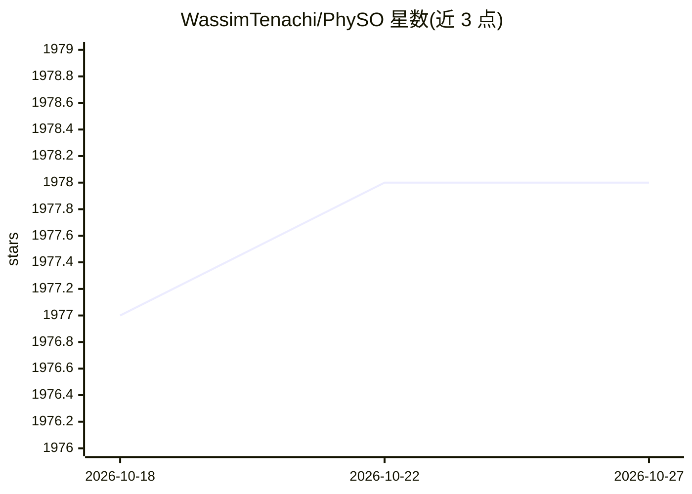

# WassimTenachi/PhySO

⭐ 1,978 · Python · MIT · 推送 2026-02-21 · [GitHub](https://github.com/WassimTenachi/PhySO) · [官网](https://physo.readthedocs.io/) · 个人维护

**物理符号优化库：用深度强化学习从数据推断解析物理定律**

面向物理研究的符号回归 Python 包：以深度强化学习在函数形式空间中搜索，从数据点推断拟合的解析表达式；可利用物理量纲约束（量纲分析）缩小搜索空间，支持 Class SR 用单一函数形式拟合多组各自带独立参数的数据集，并提供不确定性感知拟合。结果可导出为 SymPy 表达式或 LaTeX 字符串。提供 pip 与 conda 安装，SR 效果依赖超参数配置，提供 3 组预设配置。

## 筛选速览

| 维度 | 判定 | 备注 |
|---|---|---|
| AI 角色 | `ai-native` | 本体是模型或模型工具 |
| 许可风险 | `permissive` | MIT |
| 部署形态 | `library` | 以包/库形式分发 |
| 模型依赖 | — | README 未给出锁定关系 |
| 硬件要求 | — | 无带数字的原话,不猜 |
| 安装摩擦 | `low` | 无编译、无系统依赖或容器化 |
| 成熟度 | — | 结构信号不足 |

## 能力要点

- 深度强化学习驱动的符号回归，搜索解析函数形式
- 物理单位约束/量纲分析加速搜索（支持 ≤7 维单位向量）
- Class SR：单一函数形式拟合多数据集（各自独立拟合参数）
- 结果导出为 SymPy 表达式或 LaTeX 字符串

## 适用场景

- 从物理实验/模拟数据中恢复解析物理定律
- 用量纲约束加速符号回归搜索
- 对多组相关数据集拟合同一形式的表达式

## 场景标签

`科研工具` · 领域:学习与行业

## 证据(README 行号)

> L30: $\Phi$-SO's symbolic regression module uses deep reinforcement learning to infer analytical physical laws that fit 
> L34: * Physical units constraints, reducing the search space with dimensional analysis ([[Tenachi et al 2023]](https://a

## 星数曲线

2026-10-18 1,977 → 2026-10-27 1,978（+1）

---
*卡片 v1 · prompt 1.4 · 生成 2026-10-21 · 置信度 high · 依据 README sha `e66a65bf3ffb` · [字段定义](../../DATASET.md)*
