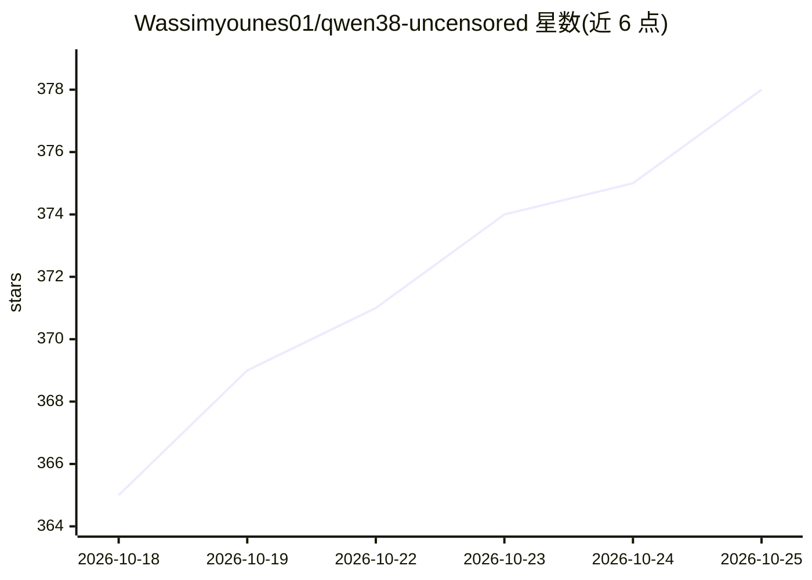

# Wassimyounes01/qwen38-uncensored

⭐ 378 · JavaScript · NOASSERTION · 推送 2026-08-20 · [GitHub](https://github.com/Wassimyounes01/qwen38-uncensored) · [官网](https://huggingface.co/unsloth/Qwen3.6-27B-GGUF/blob/main/Qwen3.6-27B-Q4_K_M.gguf) · 个人维护

**本地运行的 Qwen 3.8 27B 消融式去审查模型包及安装工具**

分发 orcarouter 的 abliterated Qwen 3.8 27B GGUF/MLX 权重（拒绝方向已从 131 个权重矩阵中正交化移除），并附带 node 安装脚本（install.cjs）：自动检测平台、选择量化版本（Q3_K_M 至 Q8_0）、生成 Modelfile，通过 Ollama 或可选的 MLX 后端（Apple Silicon 上提速 30-50%）加载运行。另含 SYSTEM pack 作为提示层面的补充，以及通过本地 11434 端口 API 调用的示例。限定 Ollama 0.17.1+。

## 筛选速览

| 维度 | 判定 | 备注 |
|---|---|---|
| AI 角色 | `ai-native` | 本体是模型或模型工具 |
| 许可风险 | `none` | NOASSERTION |
| 部署形态 | `None` |  |
| 模型依赖 | local-ok | 支持本地模型 |
| 硬件要求 | — | 无带数字的原话,不猜 |
| 安装摩擦 | `medium` | 含编译或系统依赖之一 |
| 成熟度 | — | 结构信号不足 |

## 能力要点

- 权重级消融（abliteration）：拒绝方向从 131 个权重矩阵中移除
- install.cjs 自动检测平台并选择量化版本与 Modelfile
- 8 档量化（Q3_K_M 至 Q8_0）覆盖 13.5-29.0 GB
- 可选 MLX 后端，Apple Silicon 上推理提速 30-50%

## 适用场景

- 在 Mac 或 Windows 上本地运行去审查的 Qwen 27B 模型
- 通过 Ollama 本地 API 调用对话模型
- 按显存/内存大小选择合适量化版本

## 场景标签

 · 领域:本地大模型/模型权重分发

## 证据(README 行号)

> L5:  Abliterated Qwen 3.8 27B — uncensored at the weight level, not just prompting.
> L86: All from orcarouter/Qwen3.8-27B-Uncensored-GGUF — abliterated at the weight level.
> L127: |**Loaded weights**|Abliterated `orcarouter/Qwen3.8-27B-Uncensored-GGUF` — refusal direction removed from 131 matr

## 星数曲线

2026-10-18 365 → 2026-10-25 378（+13）

---
*卡片 v1 · prompt 1.4 · 生成 2026-10-21 · 置信度 high · 依据 README sha `437b7b03bd3a` · [字段定义](../../DATASET.md)*
