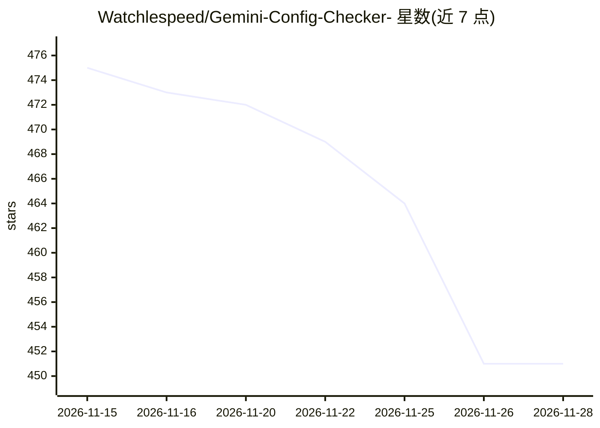

# Watchlespeed/Gemini-Config-Checker-

⭐ 451 · Makefile · Apache-2.0 · 推送 2026-11-15 · [GitHub](https://github.com/Watchlespeed/Gemini-Config-Checker-) · 个人维护

**检测哪些代理配置能真正进入 Google AI Studio 与 Gemini 的扫描器**

跨平台桌面/网页工具（Wails 封装，内嵌 Xray-core 引擎），批量测试代理配置（vless/vmess/trojan/ss、订阅链接、base64）能否访问 Google AI Studio 与 Gemini。核心机制：以登录 Google 账号的浏览器（Chrome/Edge/Brave 独立配置档）逐个实测区域封锁，因普通连通性探测无法反映 Google 按账号判定区域的策略；另提供仅连通性模式。支持 Simple/Advanced 两模式（Advanced 将免费配置链式套在可用基础配置之后）、anti-DPI 分片配置（源自 PattN 方案）、导出链接/base64/Xray 配置。限制：v0.1.0 早期预发布，仅在 Windows 实测过；区域检查约 20–40 秒/配置；Android 版仅连通性模式；判定是瞬时采样而非保证。

## 筛选速览

| 维度 | 判定 | 备注 |
|---|---|---|
| AI 角色 | `ai-enhanced` | 去掉 AI 部分产品仍成立 |
| 许可风险 | `permissive` | Apache-2.0 |
| 部署形态 | `desktop` | 安装包/桌面程序 |
| 模型依赖 | — | README 未给出锁定关系 |
| 硬件要求 | — | 无带数字的原话,不猜 |
| 安装摩擦 | `medium` | 含编译或系统依赖之一 |
| 成熟度 | `idea` | |

## 能力要点

- 签名浏览器登录态逐配置实测 Google 区域封锁（AI Studio 与 Gemini 分列判定）
- Advanced 链式模式：免费配置经由可用基础配置的隧道作为出口
- anti-DPI 配置（Finalmask 分片/指纹/ALPN/密码套件，参数可编辑）
- Windows/macOS/Linux 桌面版、Android APK 与跨平台 Web 服务端四种形态

## 适用场景

- 在受限网络找出能打开 AI Studio/Gemini 的代理配置
- 已可连接但被 Google 区域墙拦截时，为 Cloudflare 配置寻找其他可用出口
- 在依赖某个配置前先验证其是否仍可用

## 场景标签

 · 领域:网络工具/代理配置检测

## 证据(README 行号)

> L11: Find proxy configs that actually get you into **Google AI Studio and Gemini**, by testing each one the way a person
> L50: Google decides region availability **per signed-in account, after the page has loaded**. A plain HTTP request (even
> L51: with a dummy key) answers "fine" from every country, so connectivity probes mark every live config as healthy. Meas

## 星数曲线

2026-11-15 475 → 2026-11-28 451（-24）

---
*卡片 v1 · prompt 1.4 · 生成 2026-11-17 · 置信度 mid · 依据 README sha `846e83cebb20` · [字段定义](../../DATASET.md)*
