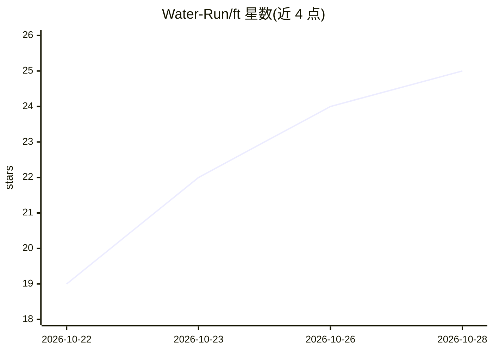

# Water-Run/ft

⭐ 26 · JavaScript · GPL-3.0 · 推送 2026-10-28 · [GitHub](https://github.com/Water-Run/ft) · [官网](https://space.bilibili.com/68328330) · 个人维护 · 中文 README

**用 LLM 协助制作科普视频的自由视频项目与制作工具链**

发布科普与项目介绍视频的自由视频项目：每部视频是以时间 t 为唯一输入的 HTML 确定性动画，由无头浏览器并行出帧、ffmpeg 编码，旁白逐句合成并驱动画面排布；LLM 参与制作，模型型号与版本在片尾署名。仓库公开事实依据、文案、审稿记录、动画源码与制作工具（kit 引擎、模板、回归测试），采用 GPL-3.0-or-later，成片发布于哔哩哔哩与 YouTube。需要 Git 与 Node.js 22.12+，看画面需 Chrome 与字体。

## 筛选速览

| 维度 | 判定 | 备注 |
|---|---|---|
| AI 角色 | `ai-native` | 本体是模型或模型工具 |
| 许可风险 | `viral` | GPL-3.0 |
| 部署形态 | `None` |  |
| 模型依赖 | — | README 未给出锁定关系 |
| 硬件要求 | — | 无带数字的原话,不猜 |
| 安装摩擦 | `medium` | 含编译或系统依赖之一 |
| 成熟度 | — | 结构信号不足 |

## 能力要点

- 画面为时间 t 的纯函数：无 CSS 动画/定时器/回调，任意帧可独立渲染
- 旁白逐句合成，词级时间戳驱动动画，文案改动后画面自动重排，同一场景代码可配多语言
- 每部片子维护 research/FACTS.md 事实出处，数字与终端回显由脚本从实验数据生成
- 公开引擎、工具、模板与回归测试，采用 GPL-3.0-or-later

## 适用场景

- 查看与学习用 LLM 协助制作的科普动画视频
- fork 工具链自行制作确定性的 HTML 动画视频
- 研究事实可追溯、多语言适配的视频制作流程

## 场景标签

 · 领域:教育/科普视频制作

## 证据(README 行号)

> L5: f(t) 用大语言模型协助制作科普与项目介绍视频。首要任务是把内容讲清楚：事实可靠，问题值得回答，叙事让观众跟得上。视觉、动画和声音为内容服务。
> L20: - **画面是时间的纯函数。** 每部视频是一段以 t 为唯一输入的 HTML 动画。不用 CSS 动画、定时器与回调，任意一帧都能独立渲染，多个无头浏览器并行出帧，再由 ffmpeg 编码封装。
> L26: - **分工按能力。** 人负责选题、审定与评价；准备方完成取证与文案，制作方负责视听制作。片尾记录实际贡献：人使用本人选定的公开署名，模型注明准确型号和版本。

## 星数曲线

2026-10-22 19 → 2026-10-28 25（+6）

---
*卡片 v1 · prompt 1.4 · 生成 2026-10-27 · 置信度 mid · 依据 README sha `f75261c5ac16` · [字段定义](../../DATASET.md)*
