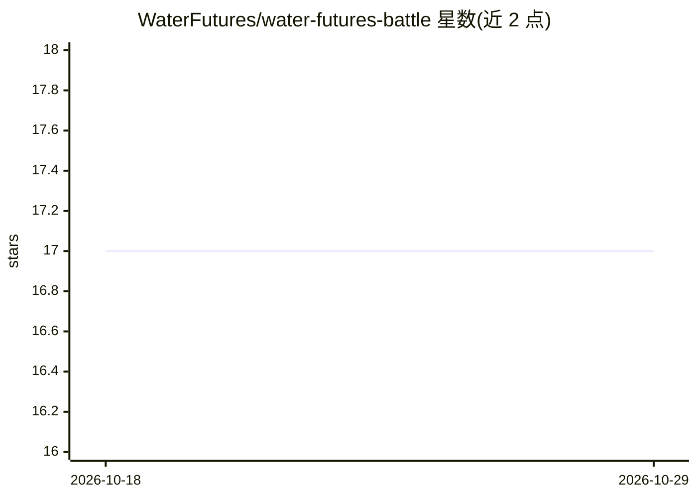

# WaterFutures/water-futures-battle

⭐ 17 · Python · MIT · 推送 2026-04-28 · [GitHub](https://github.com/WaterFutures/water-futures-battle) · [官网](https://waterfutures.github.io/water-futures-battle/) · 组织维护

**WDSA/CCWI 2026 供水系统深度不确定性设计竞赛的官方仓库**

The Battle of the Water Futures 竞赛的 GitHub 门户：竞赛在 2026 年 5 月于塞浦路斯帕福斯举办的 WDSA/CCWI 2024 联合会议上进行，任务是长期视野下在深度不确定性中分阶段设计并运行供水分配系统。README 本身仅提供竞赛介绍与外部链接（官网、Zenodo 仓库、arXiv 问题描述、GitHub 讨论页与联系邮箱），不含代码、数据或安装说明。由 Water-Futures 团队组织，受欧盟 ERC Horizon 2020 资助（Grant No. 951424）。

## 筛选速览

| 维度 | 判定 | 备注 |
|---|---|---|
| AI 角色 | `ai-knowledge` | 知识聚合/清单类 |
| 许可风险 | `permissive` | MIT |
| 部署形态 | `None` |  |
| 模型依赖 | — | README 未给出锁定关系 |
| 硬件要求 | — | 无带数字的原话,不猜 |
| 安装摩擦 | `low` | 无编译、无系统依赖或容器化 |
| 成熟度 | — | 结构信号不足 |

## 能力要点

- 任务为深度不确定性下的供水系统分阶段设计与运行
- 竞赛详情托管于官网与 Zenodo，问题描述发布于 arXiv
- 由 KWR Water-Futures 团队组织，获 ERC Horizon 2020 资助

## 适用场景

- 参加 2026 年供水系统设计竞赛并获取官方资料入口
- 查阅深度不确定性决策与多目标优化赛题描述
- 追踪 Water-Futures 团队的竞赛与研究活动

## 场景标签

 · 领域:城市水务/决策科学

## 证据(README 行号)

> L4: The Battle of the Water Futures is competition hosted at the **4th International Joint Conference on Water Distribut
> L5: The objective is to **design and operate** a water distribution system over a long-term horizon **under deep uncerta

## 星数曲线

2026-10-18 17 → 2026-10-29 17（+0）

---
*卡片 v1 · prompt 1.4 · 生成 2026-10-29 · 置信度 mid · 依据 README sha `b86c75753258` · [字段定义](../../DATASET.md)*
