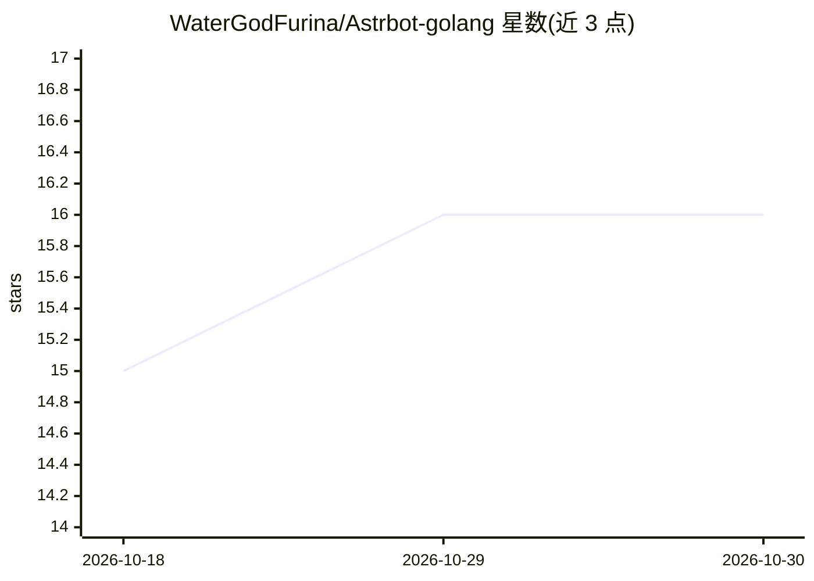

# WaterGodFurina/Astrbot-golang

⭐ 16 · Go · AGPL-3.0 · 推送 2026-10-17 · [GitHub](https://github.com/WaterGodFurina/Astrbot-golang) · 个人维护 · 中文 README

**AstrBot 的 Go 移植版：多平台聊天机器人框架**

由 Python 项目 AstrBot 迁移而来的 Go 语言聊天机器人框架，原生支持 18 个消息平台适配器（QQ/Telegram/Discord/飞书/企业微信/钉钉等）与 14 类 LLM Provider，另含 TTS/STT/Embedding/Rerank 能力。插件系统支持原生 Go 插件（gRPC 独立进程或 .so/.dll 加载）与兼容 AstrBot 生态的 Python 插件，可自动下载 Go 工具链、Python 解释器与 zig cc。核心二进制无 CGO 依赖，通过 Release 二进制或源码编译部署，提供 WebUI 管理面板（默认端口 6185）。安卓二进制无法使用插件功能，需 Termux 源码编译。

## 筛选速览

| 维度 | 判定 | 备注 |
|---|---|---|
| AI 角色 | `ai-ecosystem` | LLM/agent 周边工具 |
| 许可风险 | `viral` | AGPL-3.0 |
| 部署形态 | `library` | 以包/库形式分发 |
| 模型依赖 | local-ok | 支持本地模型 |
| 硬件要求 | — | 无带数字的原话,不猜 |
| 安装摩擦 | `medium` | 含编译或系统依赖之一 |
| 成熟度 | — | 结构信号不足 |

## 能力要点

- 18 个消息平台适配器与 14 类 LLM Provider
- Go/Python 双插件体系，崩溃自愈、热重载、闲置休眠
- 纯 Go 向量检索（nanovec）替代 FAISS，SQLite 双写保证一致性
- 自动下载 Go 工具链、CPython 独立发行版与 zig cc

## 适用场景

- 在 QQ/Telegram/Discord 等平台搭建接入 LLM 的聊天机器人
- 复用 AstrBot Python 插件生态的插件市场
- 在 Termux/安卓设备上从源码编译运行机器人

## 场景标签

`聊天机器人` · 领域:对话与助手

## 证据(README 行号)

> L10: AstrBot-golang 是一个**高性能、可扩展**的聊天机器人框架，原生支持 **18 个消息平台**、**14 类 LLM Provider**、**插件系统**（原生 Go 插件 + 兼容 Python 插件）以及 *
> L133: ## Provider 支持

## 星数曲线

2026-10-18 15 → 2026-10-30 16（+1）

---
*卡片 v1 · prompt 1.4 · 生成 2026-10-30 · 置信度 mid · 依据 README sha `5ff52b039a3f` · [字段定义](../../DATASET.md)*
