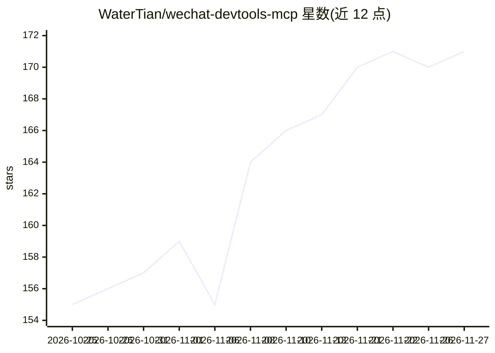

# WaterTian/wechat-devtools-mcp

⭐ 171 · MIT · 推送 2026-11-18 · [GitHub](https://github.com/WaterTian/wechat-devtools-mcp) · [官网](https://pypi.org/project/wechat-devtools-mcp/) · 个人维护 · 中文 README

**把微信开发者工具封装为 MCP 服务，供编辑器 AI 操作小程序**

该工具将微信开发者工具封装为 MCP Server，并提供配套 Skill，使编辑器中的 AI 可完成小程序的编译、预览、调试与自动化测试。MCP Server 提供 7 个聚合工具（IDE 生命周期、构建发布、自动化交互、日志采集、长图截图、页面跳转、文件读取），操作流程写在配套 Skill 的 9 条 SOP 中，两者需一起安装。运行依赖 Python ≥ 3.10、Node.js ≥ 18、微信开发者工具 2.x 或 1.06.x，需在 IDE 中开启服务端口并提供 CLI 与项目绝对路径。README 说明与官方 IDE 内建 MCP（49 个原子工具）互补而非替代。

## 筛选速览

| 维度 | 判定 | 备注 |
|---|---|---|
| AI 角色 | `ai-ecosystem` | LLM/agent 周边工具 |
| 许可风险 | `permissive` | MIT |
| 部署形态 | `library` | 以包/库形式分发 |
| 模型依赖 | — | README 未给出锁定关系 |
| 硬件要求 | — | 无带数字的原话,不猜 |
| 安装摩擦 | `low` | 无编译、无系统依赖或容器化 |
| 成熟度 | — | 结构信号不足 |

## 能力要点

- 7 个聚合 MCP 工具覆盖编译、预览、上传、自动化交互、日志与截图
- 配套 Skill 含 9 条 SOP、全 action 速查、CDP 排查策略与故障手册
- 支持 Claude Desktop、Claude Code、Cursor、Trae、Kiro 等客户端配置
- automator 连接失败自动重试，CDP 端口被占用可切换 WECHAT_CDP_PORT

## 适用场景

- 让编辑器里的 AI 编译、预览并上传小程序
- 对小程序做自动化点击、输入与运行时查询测试
- 采集 CDP 结构化日志并按页面排查异常
- 对长页面小程序做拼接截图核验

## 场景标签

`编码 Agent` · 领域:编码与开发

## 证据(README 行号)

> L10: > 把微信开发者工具封装为 MCP 服务，让编辑器里的 AI 直接完成小程序的**编译、预览、调试、自动化测试**闭环。Windows / macOS，已上架官方 MCP Registry。
> L13: > 「瘦 MCP + 胖 Skill」：MCP Server 只提供 7 个聚合工具，操作流程与最佳实践都在配套的 wechat-devtools Skill 里。**两者必须一起装**。

## 星数曲线

2026-10-25 155 → 2026-11-27 171（+16）

---
*卡片 v1 · prompt 1.4 · 生成 2026-11-26 · 置信度 high · 依据 README sha `996687ecd261` · [字段定义](../../DATASET.md)*
