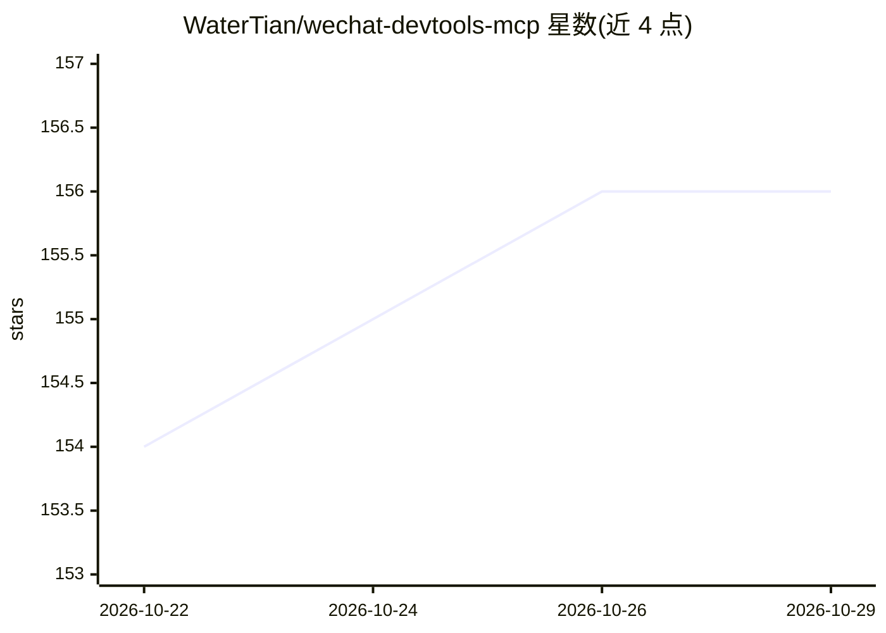

# WaterTian/wechat-devtools-mcp

⭐ 156 · Python · MIT · 推送 2026-10-26 · [GitHub](https://github.com/WaterTian/wechat-devtools-mcp) · 个人维护 · 中文 README

**封装微信开发者工具为 MCP 服务，让编辑器 AI 编译调试小程序**

将微信开发者工具 CLI 封装为 MCP Server，提供 7 个聚合工具，覆盖 IDE 生命周期、编译/预览/上传、自动化交互（tap/input/evaluate 等）、CDP 结构化日志、长图拼接截图、页面跳转与项目文件读取。采用「瘦 MCP + 胖 Skill」架构，操作流程与 9 条 SOP 在配套 Skill 中，两者必须一起安装。面向在 Claude Desktop/Claude Code/Cursor 等编辑器中使用 AI 开发微信小程序的开发者。需开启开发者工具服务端口并配置两个必填环境变量；与 2.x 官方内建 MCP 互补，并继续兼容存量 1.06.x。

## 筛选速览

| 维度 | 判定 | 备注 |
|---|---|---|
| AI 角色 | `ai-ecosystem` | LLM/agent 周边工具 |
| 许可风险 | `permissive` | MIT |
| 部署形态 | `library` | 以包/库形式分发 |
| 模型依赖 | — | README 未给出锁定关系 |
| 硬件要求 | — | 无带数字的原话,不猜 |
| 安装摩擦 | `low` | 无编译、无系统依赖或容器化 |
| 成熟度 | — | 结构信号不足 |

## 能力要点

- 7 个聚合工具：IDE/构建/自动化/日志采集/长图截图/跳转/文件读取
- 配套 Skill 含 9 条 SOP、工具速查与故障手册
- 长图拼接截图与 CDP 结构化日志为官方内建 MCP 未覆盖的能力
- 适配开发者工具 2.x Stable 并兼容存量 1.06.x（NW.js）

## 适用场景

- 让编辑器里的 AI 直接完成小程序编译、预览与上传
- 用一句话跑完小程序巡检或跨页面校验的任务级 SOP
- 采集 CDP 结构化日志做异常排查

## 场景标签

`编码 Agent` · 领域:编码与开发

## 证据(README 行号)

> L8: > 把微信开发者工具封装为 MCP 服务，让编辑器里的 AI 直接完成小程序的**编译、预览、调试、自动化测试**闭环。Windows / macOS，已上架官方 MCP Registry。
> L11: > 「瘦 MCP + 胖 Skill」：MCP Server 只提供 7 个聚合工具，操作流程与最佳实践都在配套的 wechat-devtools Skill 里。**两者必须一起装**。
> L93: |工具|用途|action / 关键参数|

## 星数曲线

2026-10-22 154 → 2026-10-29 156（+2）

---
*卡片 v1 · prompt 1.4 · 生成 2026-10-22 · 置信度 high · 依据 README sha `997eb1041b5b` · [字段定义](../../DATASET.md)*
