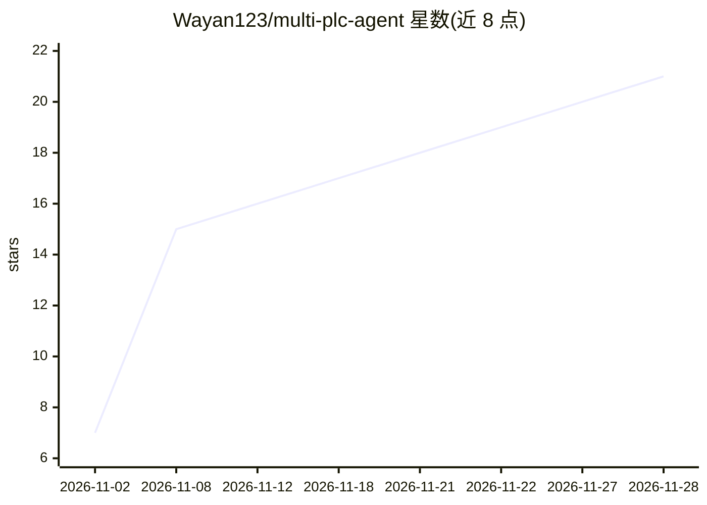

# Wayan123/multi-plc-agent

⭐ 21 · Python · Apache-2.0 · 推送 2026-11-04 · [GitHub](https://github.com/Wayan123/multi-plc-agent) · 个人维护

**统一 MCP 服务器：让 AI agent 在 10 种 PLC 工程软件中编写梯形图**

为工业自动化开发者提供的 MCP 服务器聚合层：对 Mitsubishi GX Works2、Siemens TIA Portal、Omron CX-Programmer/Sysmac Studio、CODESYS、Schneider、Delta、Beckhoff TwinCAT、Outseal、Haiwell 共 10 种工具各起一个后端，加厂商前缀后以单一服务器暴露。写入方式包括驱动 UI、官方 API、ScriptEngine、直接编辑工程文件与 UI Automation。每后端保留各自审批流程与安全检查，路由层不暴露作用于在线 PLC 或删除项目内容的工具。部分后端复用第三方项目，其余位于 backends/ 目录。勾选项均经真实软件编译 0 错误并回读匹配验证；未验证组合列为计划项。

## 筛选速览

| 维度 | 判定 | 备注 |
|---|---|---|
| AI 角色 | `ai-ecosystem` | LLM/agent 周边工具 |
| 许可风险 | `permissive` | Apache-2.0 |
| 部署形态 | `desktop` | 安装包/桌面程序 |
| 模型依赖 | — | README 未给出锁定关系 |
| 硬件要求 | — | 无带数字的原话,不猜 |
| 安装摩擦 | `low` | 无编译、无系统依赖或容器化 |
| 成熟度 | — | 结构信号不足 |

## 能力要点

- 10 种 PLC 工具（9 厂商/平台）统一为一个 MCP 服务器
- 共享安全规则：作用于在线 PLC 或删除项目内容的工具不予暴露
- 支持状态仅在真实软件上写入、编译 0 错误、回读匹配后勾选
- 提供 7 类教育示例：数字 I/O、模拟量、Modbus、交通灯等

## 适用场景

- 让 Claude 类 agent 直接在现有 PLC 工程软件中生成梯形图程序
- 跨多厂商 PLC 平台复用同一套 AI 编程接入方式
- 教学场景下生成数字/模拟 I/O 与交通灯等示例工程

## 场景标签

`代码生成` · 领域:编码与开发

## 证据(README 行号)

> L5: One MCP server that lets an AI agent write ladder logic in many PLC engineering tools: Mitsubishi GX Works2, Siemens
> L7: multi-plc-agent starts one MCP server per tool, gives every tool a vendor prefix (`mitsubishi_`, `siemens_`, `omron_

## 星数曲线

2026-11-02 7 → 2026-11-28 21（+14）

---
*卡片 v1 · prompt 1.4 · 生成 2026-11-18 · 置信度 high · 依据 README sha `5f70bd370c95` · [字段定义](../../DATASET.md)*
