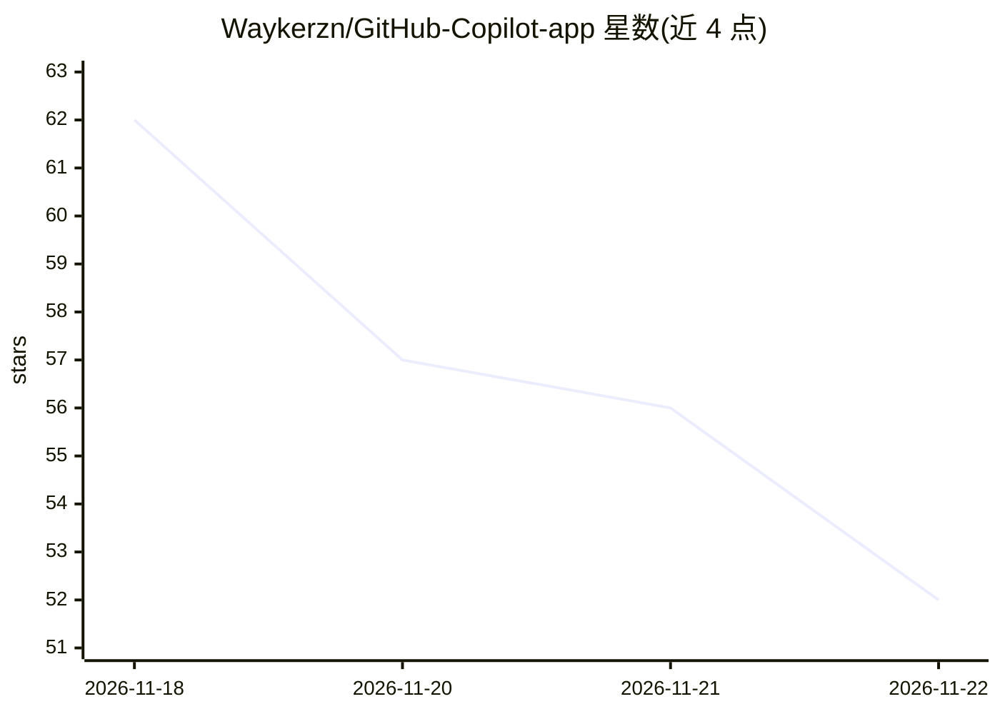

# Waykerzn/GitHub-Copilot-app

⭐ 52 · Apache-2.0 · 推送 2026-11-19 · [GitHub](https://github.com/Waykerzn/GitHub-Copilot-app) · 组织维护

**跨 GitHub 仓库管理 agent 开发工作的桌面应用**

GitHub 官方的 agent-native 桌面应用，为从想法到 pull request 的软件开发流程提供统一控制中心：查找工作项、启动与引导 agent、审查进度并落地变更。本地会话运行在隔离的 git worktree，云会话在 GitHub 托管的隔离环境中运行；Canvas 将 agent 的计划、终端、diff 等变为可检查的共享界面。含 My Work 聚合面板、定时/后台 Automations 与 Agent Merge。需要 Git 与任一 Copilot 计划，或通过 BYOK 自带模型密钥使用；通过安装包下载分发。

## 筛选速览

| 维度 | 判定 | 备注 |
|---|---|---|
| AI 角色 | `ai-ecosystem` | LLM/agent 周边工具 |
| 许可风险 | `permissive` | Apache-2.0 |
| 部署形态 | `desktop` | 安装包/桌面程序 |
| 模型依赖 | — | README 未给出锁定关系 |
| 硬件要求 | — | 无带数字的原话,不猜 |
| 安装摩擦 | `low` | 无编译、无系统依赖或容器化 |
| 成熟度 | — | 结构信号不足 |

## 能力要点

- 本地会话在隔离 git worktree 中并行运行，云会话在 GitHub 托管环境执行
- Canvas 将 agent 工作变为共享、可检查、可干预的界面
- My Work 聚合会话、issue、PR 与仓库上下文
- 支持 BYOK，无需 Copilot 计划也可用自带模型密钥

## 适用场景

- 并行让 agent 调查 bug、实现 issue、处理评审反馈
- 在单一界面审查 agent 进度并推进 PR 到合并
- 把重复的提示与工作流转为定时或后台任务

## 场景标签

`编码 Agent` · 领域:编码与开发

## 证据(README 行号)

> L13: The GitHub Copilot app is an agent-native desktop experience for managing software work from idea to pull request. 
> L15: The app is built for parallel agent-driven development. Each local session runs in its own isolated git worktree, a
> L26: - A GitHub Copilot plan — any plan works, including Copilot Free and GitHub Copilot Student. No Copilot plan? You c

## 星数曲线

2026-11-18 62 → 2026-11-22 52（-10）

---
*卡片 v1 · prompt 1.4 · 生成 2026-11-20 · 置信度 high · 依据 README sha `ace8298341b4` · [字段定义](../../DATASET.md)*
