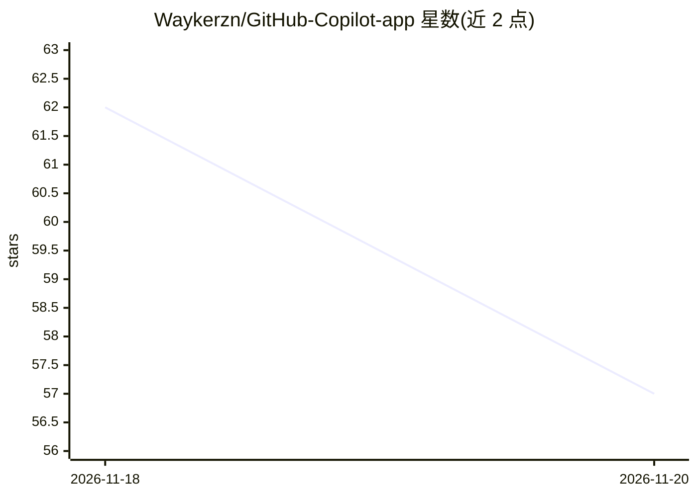

# Waykerzn/GitHub-Copilot-app

⭐ 57 · Apache-2.0 · 推送 2026-11-19 · [GitHub](https://github.com/Waykerzn/GitHub-Copilot-app) · 组织维护

**面向开发者的 agent 原生桌面端 GitHub 工作管理中心**

GitHub 官方发布的桌面应用，作为管理软件工作的单一控制中心：从发现任务、启动并引导 agent、审查进度到落地变更，覆盖从想法到 pull request 的流程。本地会话在独立 git worktree 中运行，云会话使用 GitHub 托管的隔离环境，支持并行 agent 开发；Canvas 展示 agent 工作状态，My Work 聚合会话、issue 与 PR，Automations 将提示词转为定时/后台任务，Agent Merge 协助走完 PR 审查与合并。需 Git 与任一 Copilot 计划，或以 BYOK 自带 key 接入自己的模型提供方。发行版通过下载链接与 Releases 页分发，仓库标注 © GitHub 保留所有权利，并声明收集使用数据与对话数据。

## 筛选速览

| 维度 | 判定 | 备注 |
|---|---|---|
| AI 角色 | `ai-native` | 本体是模型或模型工具 |
| 许可风险 | `permissive` | Apache-2.0 |
| 部署形态 | `desktop` | 安装包/桌面程序 |
| 模型依赖 | — | README 未给出锁定关系 |
| 硬件要求 | — | 无带数字的原话,不猜 |
| 安装摩擦 | `low` | 无编译、无系统依赖或容器化 |
| 成熟度 | — | 结构信号不足 |

## 能力要点

- 本地会话在独立 git worktree、云会话在 GitHub 托管隔离环境中运行
- Canvas 将 agent 的计划、diff、工作流状态转为可检视的共享界面
- Automations 将可复用提示词转为定时或后台任务，Agent Merge 协助 PR 合并
- 支持 Copilot 计划或 BYOK 自带 key 接入自己的模型提供方

## 适用场景

- 并行启动多个 agent 处理 bug 修复、issue 实现与评审反馈
- 在一个界面中管理跨仓库的会话、issue 与 pull request
- 把重复性工作流配置为定时或后台自动化任务

## 场景标签

`编码 Agent` · 领域:编码与开发

## 证据(README 行号)

> L3: The GitHub Copilot app is an agent-native desktop experience for finding, running, steering, and landing software wo
> L13: The GitHub Copilot app is an agent-native desktop experience for managing software work from idea to pull request. 
> L15: The app is built for parallel agent-driven development. Each local session runs in its own isolated git worktree, a

## 星数曲线

2026-11-18 62 → 2026-11-20 57（-5）

---
*卡片 v1 · prompt 1.4 · 生成 2026-11-19 · 置信度 high · 依据 README sha `db7fa9f8df45` · [字段定义](../../DATASET.md)*
