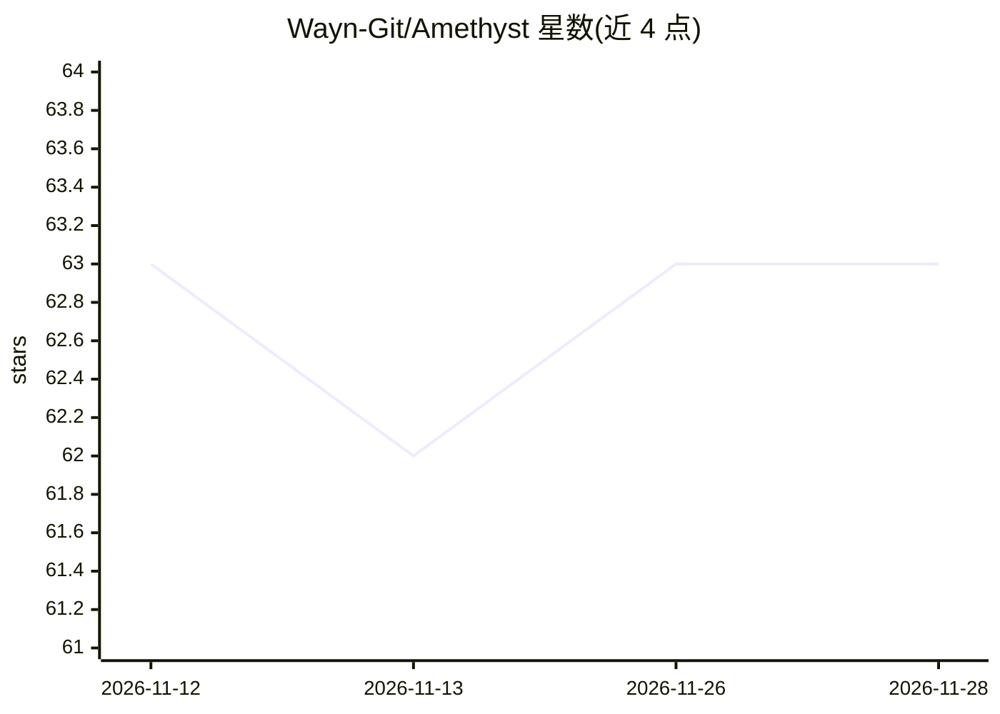

# Wayn-Git/Amethyst

⭐ 63 · Python · MIT · 推送 2026-11-22 · [GitHub](https://github.com/Wayn-Git/Amethyst) · [官网](https://vault-silk-nine.vercel.app) · 个人维护

**本地优先的个人操作系统：一个 AI agent 管理文件、任务、日历与笔记**

面向个人用户的本地优先 AI 助手应用：单个 agent 循环（推理-行动-观察）统一操作日历、邮件、任务、文件与笔记，工具调用逐流式展示且每次操作需经权限门。核心机制包括八种来源聚合的 Library 知识库（纯 markdown 存储）、MCP 连接器注册、markdown 技能文件、子 agent 并行任务与任务感知搜索路由。技术栈 Python 3.11+ / FastAPI / SQLite / React，数据全部留在本机；支持 Ollama 本地模型零成本运行或 21 个云端 provider 预设。提供 macOS/Windows/Linux 桌面安装包、Docker 与源码运行三种方式。

## 筛选速览

| 维度 | 判定 | 备注 |
|---|---|---|
| AI 角色 | `ai-native` | 本体是模型或模型工具 |
| 许可风险 | `permissive` | MIT |
| 部署形态 | `desktop` | 安装包/桌面程序 |
| 模型依赖 | local-ok | 支持本地模型 |
| 硬件要求 | — | 无带数字的原话,不猜 |
| 安装摩擦 | `low` | 无编译、无系统依赖或容器化 |
| 成熟度 | — | 结构信号不足 |

## 能力要点

- 操作级权限门：批准读取不等于批准写入，常设批准可随时撤销
- 八种捕获路径统一进入 Library，纯 markdown 落盘于 ~/.amethyst/library/
- MCP 连接器（stdio/SSE/streamable HTTP）注册进统一工具表
- 子 agent 并行执行，带深度限制、心跳与过期自动回收

## 适用场景

- 用一个对话界面管理我的任务、日历、邮件和文件
- 把链接、笔记、文件统一收集成可语义搜索的个人知识库
- 配合 Ollama 在本机零成本、零云端地运行 AI 助手
- 设定定时提示词自动化生成晨间简报

## 场景标签

`AI 助手` `知识库管理` `语义搜索` · 领域:对话与助手

## 证据(README 行号)

> L5: **One AI interface to your apps, information, tasks and tools.**
> L12: Amethyst runs an agent loop that reasons, acts, and observes — streaming every
> L15: everything you save; and works with local models through Ollama for a zero-cost,

## 星数曲线

2026-11-12 63 → 2026-11-28 63（+0）

---
*卡片 v1 · prompt 1.4 · 生成 2026-11-18 · 置信度 high · 依据 README sha `d6031d2ee12a` · [字段定义](../../DATASET.md)*
