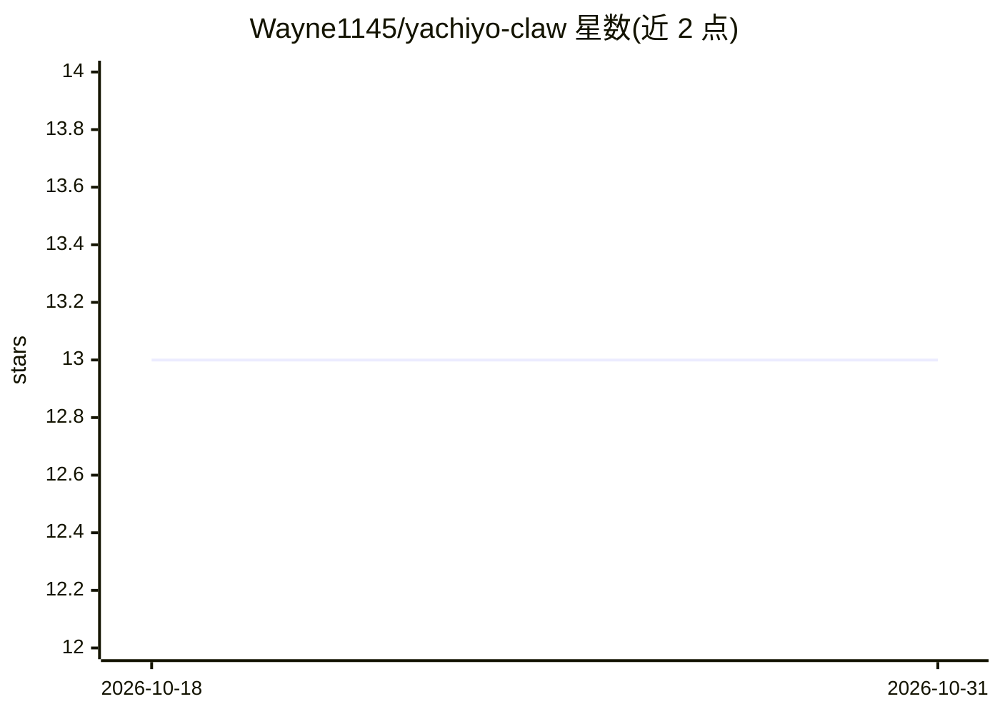

# Wayne1145/yachiyo-claw

⭐ 13 · TypeScript · GPL-3.0 · 推送 2026-10-24 · [GitHub](https://github.com/Wayne1145/yachiyo-claw) · 组织维护 · 中文 README

**Android 端开源 AI 聊天与设备 Agent 应用，支持端侧模型**

基于 Chatbox 代码基础的 Android AI 客户端：多模型对话（Yachiyo API、OpenAI-compatible、Responses API），设备 Agent 提供无障碍/Shizuku/root 三种执行后端与手动审批/AI 预审模式；端侧经 LiteRT-LM 与 llama.cpp 加载 .litertlm/.gguf 模型（CPU/Vulkan 路径）；含 Live2D 实时交互、本地 RAG、PRoot Linux 沙箱的 Vibe Coding、Skills 与 MCP 客户端。GitHub Releases 提供预览 APK，需 Android 11+；项目自述处于早期预览阶段，NPU 与系统性能验证未完成。

## 筛选速览

| 维度 | 判定 | 备注 |
|---|---|---|
| AI 角色 | `ai-native` | 本体是模型或模型工具 |
| 许可风险 | `viral` | GPL-3.0 |
| 部署形态 | `library` | 以包/库形式分发 |
| 模型依赖 | local-ok | 支持本地模型 |
| 硬件要求 | — | 无带数字的原话,不猜 |
| 安装摩擦 | `low` | 无编译、无系统依赖或容器化 |
| 成熟度 | `idea` | |

## 能力要点

- 设备 Agent 支持 Root/Shizuku/无障碍三种执行后端与分级审批模式
- 端侧加载 .litertlm 与 .gguf 模型，CPU/Vulkan 路径与性能实测
- PRoot Linux 沙箱提供 Bash/Python/Node.js 的 Vibe Coding 环境
- Live2D 实时交互含 WebSocket 音视频通话与本地 Sherpa-ONNX 语音识别

## 适用场景

- 在 Android 手机上粘贴 API Key 后直接使用多模型 AI 聊天
- 让 Agent 操作手机完成自动化任务（含定时任务）
- 在手机本地运行对话模型并搭建本地知识库检索
- 通过 Live2D 角色进行语音视频实时交互

## 场景标签

`聊天机器人` `文档问答` `GUI 自动化` `语音 Agent` · 领域:效率与自动化

## 证据(README 行号)

> L15: Yachiyo Claw 是一个 Android 优先的 AI 客户端。它在 Chatbox 的多模型对话基础上加入了直接运行于 Android 应用中的设备 Agent、Live2D 交互式对话、语音与摄像头输入、角色人格、端侧
> L28: - Yachiyo API 开箱配置，API 主机固定为 `https://api.yachiyo8000.cn/v1`，支持服务端模型列表。
> L37: - Android 原生接入 LiteRT-LM 与 llama.cpp，可分别加载 `.litertlm` 和单文件/完整分片的 `.gguf` 对话模型；接入 MediaPipe Text Embedder，可使用已下载的 `

## 星数曲线

2026-10-18 13 → 2026-10-31 13（+0）

---
*卡片 v1 · prompt 1.4 · 生成 2026-10-31 · 置信度 high · 依据 README sha `044578081b0e` · [字段定义](../../DATASET.md)*
