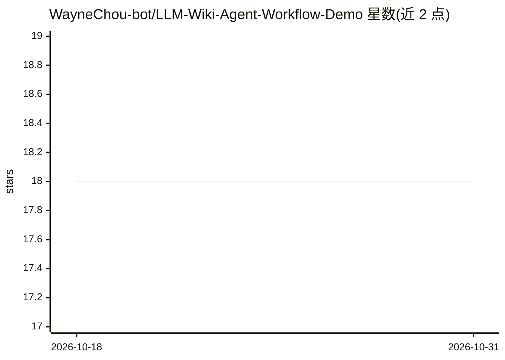

# WayneChou-bot/LLM-Wiki-Agent-Workflow-Demo

⭐ 18 · HTML · MIT · 推送 2026-08-13 · [GitHub](https://github.com/WayneChou-bot/LLM-Wiki-Agent-Workflow-Demo) · [官网](https://llm-wiki-agent-workflow-demo.vercel.app) · 个人维护 · 中文 README

**多 Agent 编译原始资料为持久 Markdown 维基的演示应用**

受 Karpathy LLM Wiki 启发的演示项目：保留 raw/wiki/AGENTS.md 三层结构与 Ingest/Query/Lint 三操作，加入四个 Agent 角色（编程/UI/项目管理/个人知识）从各自视角编译同一原始资料为 wiki 页面，并生成可交互知识图谱。提供两种形态：纯静态双语展示站（浏览器直接打开，无后端无 API key）和本地 Streamlit 应用（接入 Gemini API，默认 gemini-2.5-flash，写入真实 Markdown 文件，可作 Obsidian vault 打开）。README 声明非原版 1:1 复刻，Lint 为浅层检查（无矛盾检测）。

## 筛选速览

| 维度 | 判定 | 备注 |
|---|---|---|
| AI 角色 | `ai-native` | 本体是模型或模型工具 |
| 许可风险 | `permissive` | MIT |
| 部署形态 | `library` | 以包/库形式分发 |
| 模型依赖 | — | README 未给出锁定关系 |
| 硬件要求 | — | 无带数字的原话,不猜 |
| 安装摩擦 | `low` | 无编译、无系统依赖或容器化 |
| 成熟度 | — | 结构信号不足 |

## 能力要点

- 四个 Agent 角色分别编译同一原始资料为各自视角的 wiki 页面
- 双层形态：零依赖静态展示站 + 接 Gemini API 的本地 Streamlit 应用
- 写入真实 Markdown 文件，wiki 目录可直接作为 Obsidian vault
- Ingest 幂等（重复摄取更新同一页面）并自动生成跨页面链接与知识图谱

## 适用场景

- 学习 Karpathy LLM Wiki 模式的多 Agent 变体教学演示
- 把原始资料编译成可浏览、可交叉链接的个人知识库
- 在 Obsidian 中查看 Agent 生成的知识页面

## 场景标签

`多智能体` `知识库管理` `教程课程` · 领域:Agent 开发

## 证据(README 行号)

> L10: > (Ingest / Query / Lint), but adds a **multi-perspective remix**: four agent
> L28: |**`app.py` Streamlit app**|Local machine|The full 8-tab workflow (Showcase → Inputs → Agents → Knowledge → Concept

## 星数曲线

2026-10-18 18 → 2026-10-31 18（+0）

---
*卡片 v1 · prompt 1.4 · 生成 2026-10-29 · 置信度 high · 依据 README sha `8e0ecb97c64e` · [字段定义](../../DATASET.md)*
