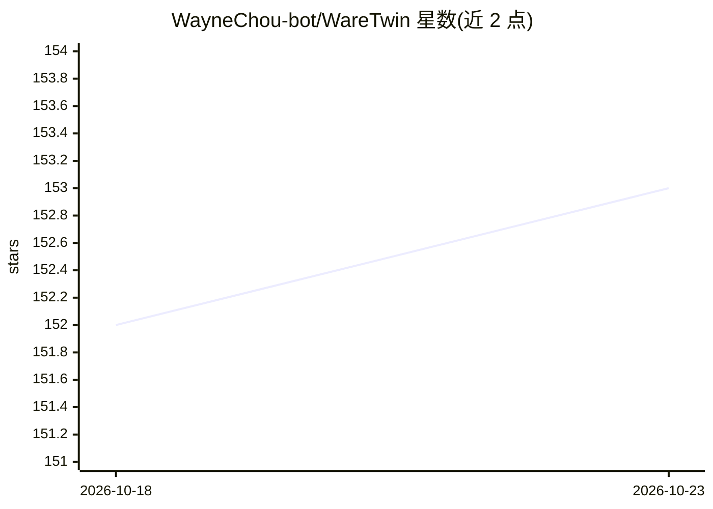

# WayneChou-bot/WareTwin

⭐ 153 · TypeScript · MIT · 推送 2026-09-11 · [GitHub](https://github.com/WayneChou-bot/WareTwin) · [官网](https://ware-twin.vercel.app) · 个人维护 · 中文 README

**面向仓库机器人车队的浏览器端 3D 数字孪生仿真平台**

在浏览器中对 100×70 米仓库、20 台 AMR 做确定性实时仿真的数字孪生：100ms tick 引擎驱动 FSM、8 向 A* 寻路与电池调度，Fleet Manager 给出可解释的任务评分，支持故障注入、what-if 多种子对比（克隆引擎不触碰在线系统）、审计日志与 KPI 导出。AI 层为可选增强：Operations Copilot 问答（默认无 key 的规则模式，可切 gpt-4o-mini）、虚拟 CCTV 的 VLM 感知。前端 React Three Fiber，后端 FastAPI + WebSocket，后端不可用时浏览器内置 TypeScript 引擎可独立运行。给机器人/物流系统开发者与评估者使用；仓库布局为合成数据，不使用真实地图。

## 筛选速览

| 维度 | 判定 | 备注 |
|---|---|---|
| AI 角色 | `ai-enhanced` | 去掉 AI 部分产品仍成立 |
| 许可风险 | `permissive` | MIT |
| 部署形态 | `self-host` | docker 或自建部署 |
| 模型依赖 | — | README 未给出锁定关系 |
| 硬件要求 | — | 无带数字的原话,不猜 |
| 安装摩擦 | `low` | 无编译、无系统依赖或容器化 |
| 成熟度 | — | 结构信号不足 |

## 能力要点

- 确定性 100ms tick 仿真：FSM、8 向 A*、栅格预约、电池与充电调度
- 可解释 Fleet Manager：展示选中理由与每个被拒候选的失分原因
- what-if 仿真克隆引擎运行 1-10 分钟并逐 tick diff 事件流，多种子 KPI 区间
- AI 层无 key 可运行：规则模式 Copilot 与仿真 VLM，可选接入 OpenAI 模型

## 适用场景

- 在真实部署前仿真 AMR 车队调度与故障场景
- 注入复合故障验证系统韧性并对比 KPI 基线
- 向运维/管理层解释吞吐下降等决策原因

## 场景标签

 · 领域:机器人/物流仿真

## 证据(README 行号)

> L23: WareTwin is a real-time **3D digital twin** of a 100 × 70 m warehouse with **20 autonomous mobile robots**, four zo
> L25: It runs on a laptop with an integrated GPU — no RTX, no ROS, no cloud required.
> L58: The AI layer never needs a key to run. Set `OPENAI_API_KEY` in `backend/.env` (see `.env.example`) to switch from d

## 星数曲线

2026-10-18 152 → 2026-10-23 153（+1）

---
*卡片 v1 · prompt 1.4 · 生成 2026-10-23 · 置信度 high · 依据 README sha `f38b50c1c4b2` · [字段定义](../../DATASET.md)*
