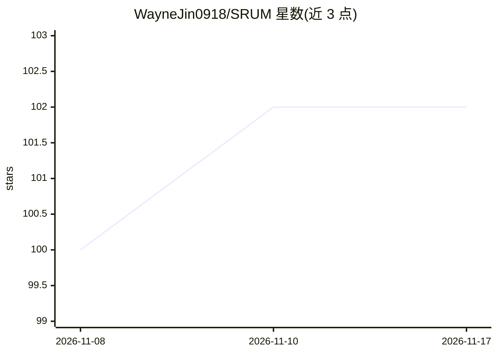

# WayneJin0918/SRUM

⭐ 102 · Python · Apache-2.0 · 推送 2025-11-26 · [GitHub](https://github.com/WayneJin0918/SRUM) · [官网](https://waynejin0918.github.io/srum_web/) · 组织维护

**统一多模态模型的自奖励后训练方法（科研代码）**

ECCV 投稿的科研工作：提出 SRUM（Fine-Grained Self-Rewarding for Unified Multimodal Models），一种基于统一多模态模型（UMMs）的后训练奖励微调方法，利用模型自身的理解能力打分来提升生成能力。在 Bagel 与 BLIP3o 上训练并在 T2I-CompBench 组合性与推理类基准上评测；训练流程含多卡数据推理（VLM 打分，需下载 SAM 权重）、yaml 配置训练脚本、权重转 HF 格式与 CompBench 评测（推荐 Qwen2.5-VL-72B 打分）。提供 HuggingFace/ModelScope 模型、数据集与在线 Demo，Apache 2.0 许可。

## 筛选速览

| 维度 | 判定 | 备注 |
|---|---|---|
| AI 角色 | `ai-native` | 本体是模型或模型工具 |
| 许可风险 | `permissive` | Apache-2.0 |
| 部署形态 | `library` | 以包/库形式分发 |
| 模型依赖 | — | README 未给出锁定关系 |
| 硬件要求 | — | 无带数字的原话,不猜 |
| 安装摩擦 | `low` | 无编译、无系统依赖或容器化 |
| 成熟度 | — | 结构信号不足 |

## 能力要点

- 细粒度自奖励的 UMM 后训练微调方法，附训练与评测脚本
- 发布 Bagel/BLIP3o 上的 SRUM 检查点与 6k 训练数据
- 提供 HuggingFace Spaces 在线 Demo
- 附 T2I-CompBench 评测流程（VLM 打分）

## 适用场景

- 复现论文或用 SRUM 方法微调自己的统一多模态模型
- 在 T2I-CompBench 等基准上评测生成模型
- 直接下载 SRUM 检查点做图像生成/编辑

## 场景标签

`微调` `图像生成` `模型评测` · 领域:评测与运维

## 证据(README 行号)

> L40: # SRUM: Fine-Grained Self-Rewarding for Unified Multimodal Models
> L45: > We present **SRUM**, a post-training reward fine-tuning method based on Unified Multimodal Models (UMMs) leverage
> L107: ### Train

## 星数曲线

2026-11-08 100 → 2026-11-17 102（+2）

---
*卡片 v1 · prompt 1.4 · 生成 2026-11-17 · 置信度 high · 依据 README sha `149a6297167d` · [字段定义](../../DATASET.md)*
