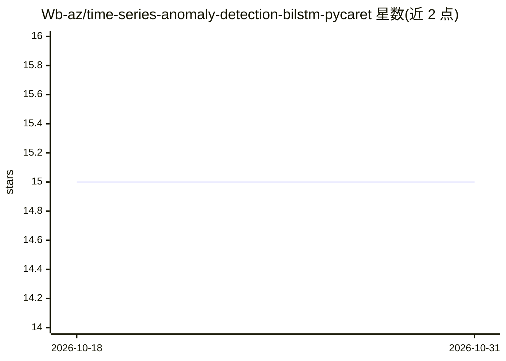

# Wb-az/time-series-anomaly-detection-bilstm-pycaret

⭐ 15 · Jupyter Notebook · MIT · 推送 2026-05-11 · [GitHub](https://github.com/Wb-az/time-series-anomaly-detection-bilstm-pycaret) · 个人维护

**在 NASA IMS 轴承数据上对比 PyCaret 与 BiLSTM 的异常检测研究**

面向预测性维护的对比研究项目：在 NASA IMS 轴承振动数据集（Set 2 训练、Set 3 独立测试，经 FFT 去噪）上，比较六个 PyCaret 无监督异常检测模型（CBLOF、iForest、HBOS、KNN、OCSVM、MCD）与自定义 PyTorch BiLSTM 自编码器的表现。评估采用聚类质量指标（Silhouette/Calinski-Harabasz/Davies-Bouldin）与 Friedman 及 Friedman-Conover 非参数统计检验。README 为研究报告形式，报告了各模型检测结果、指标与提前检测时长（BiLSTM 最长约 27 小时，iForest 约 25.5 小时）。限制：README 未展示可复现的安装与运行命令。

## 筛选速览

| 维度 | 判定 | 备注 |
|---|---|---|
| AI 角色 | `ai-native` | 本体是模型或模型工具 |
| 许可风险 | `permissive` | MIT |
| 部署形态 | `library` | 以包/库形式分发 |
| 模型依赖 | — | README 未给出锁定关系 |
| 硬件要求 | — | 无带数字的原话,不猜 |
| 安装摩擦 | `low` | 无编译、无系统依赖或容器化 |
| 成熟度 | — | 结构信号不足 |

## 能力要点

- 六个 PyCaret 无监督异常检测模型与自定义 BiLSTM 自编码器同数据对比
- 使用聚类质量指标与 Friedman/Friedman-Conover 非参数检验
- 在独立测试集上 BiLSTM 提前检测异常约 27 小时，iForest 约 25.5 小时

## 适用场景

- 为轴承振动数据的预测性维护选择异常检测方法
- 参考低代码（PyCaret）与深度学习方案的对比实验设计
- 复用基于 NASA IMS 数据集的异常检测评估流程

## 场景标签

 · 领域:工业/时序异常检测

## 证据(README 行号)

> L6: This project compares six unsupervised anomaly detection models implemented through PyCaret with a custom Bidirectio
> L20: This project benchmarks six PyCaret-based unsupervised anomaly detection models against a custom Bidirectional LSTM
> L103: A custom Bidirectional LSTM autoencoder was implemented in PyTorch to encode and reconstruct the vibration signal 

## 星数曲线

2026-10-18 15 → 2026-10-31 15（+0）

---
*卡片 v1 · prompt 1.4 · 生成 2026-10-30 · 置信度 mid · 依据 README sha `63cc3713c296` · [字段定义](../../DATASET.md)*
