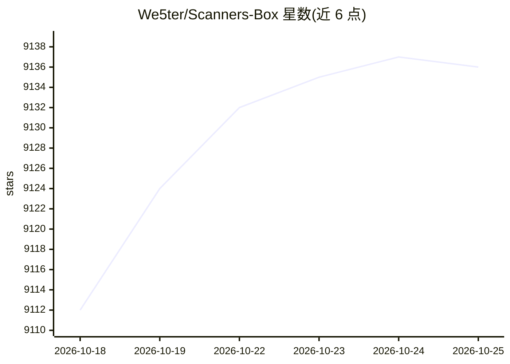

# We5ter/Scanners-Box

⭐ 9,136 · NOASSERTION · 推送 2026-10-16 · [GitHub](https://github.com/We5ter/Scanners-Box) · [官网](https://we5ter.github.io/ai-tools/) · 个人维护 · 中文 README

**面向黑客、企业与 AI 智能体的开源安全工具聚合清单**

一个多语言（英/中/西）的安全工具矩阵式清单仓库：按 AI 自主网络安全 Agent、LLM 驱动漏洞扫描器、AI 应用与 Agent 安全审计、Agent 运行时管控、Agent 技能安全扫描、智能合约审计、红蓝对抗（供应链/容器集群/指纹识别/中间人/框架）等类别收录数百个开源工具条目，每条附 GitHub 链接与简介、stars 与最近提交徽章。本体不含代码，不提供安装运行方式，另有 Daily AI Tool Picks 每日栏目与 ScanCodex MCP Server 附属项目入口。给安全从业者与 AI Agent 开发者做工具选型参考。

## 筛选速览

| 维度 | 判定 | 备注 |
|---|---|---|
| AI 角色 | `ai-knowledge` | 知识聚合/清单类 |
| 许可风险 | `none` | NOASSERTION |
| 部署形态 | `None` |  |
| 模型依赖 | — | README 未给出锁定关系 |
| 硬件要求 | — | 无带数字的原话,不猜 |
| 安装摩擦 | `low` | 无编译、无系统依赖或容器化 |
| 成熟度 | — | 结构信号不足 |

## 能力要点

- 按 AI 安全（Agent/LLM/MCP/技能）与传统安全（容器/智能合约/内网渗透）双线分类组织
- 每条目附简介、stars 与最近提交动态徽章
- 覆盖 AI Agent 运行时沙箱与治理类工具条目
- 英/中/西三语介绍

## 适用场景

- 寻找 AI Agent 与 LLM 应用安全审计工具
- 查找渗透测试与红队自动化工具
- 对比容器、Kubernetes 与智能合约扫描器
- 了解 AI 安全工具生态的覆盖范围

## 场景标签

`网络安全` `精选清单` · 领域:学习与行业

## 证据(README 行号)

> L12: - **EN** The Ultimate Open-Source Security Arsenal for Hackers, Enterprises, and AI Agents
> L23: ### AI Autonomous Cybersecurity Agents

## 星数曲线

2026-10-18 9,112 → 2026-10-25 9,136（+24）

---
*卡片 v1 · prompt 1.4 · 生成 2026-10-20 · 置信度 high · 依据 README sha `45c0d07fa74f` · [字段定义](../../DATASET.md)*
