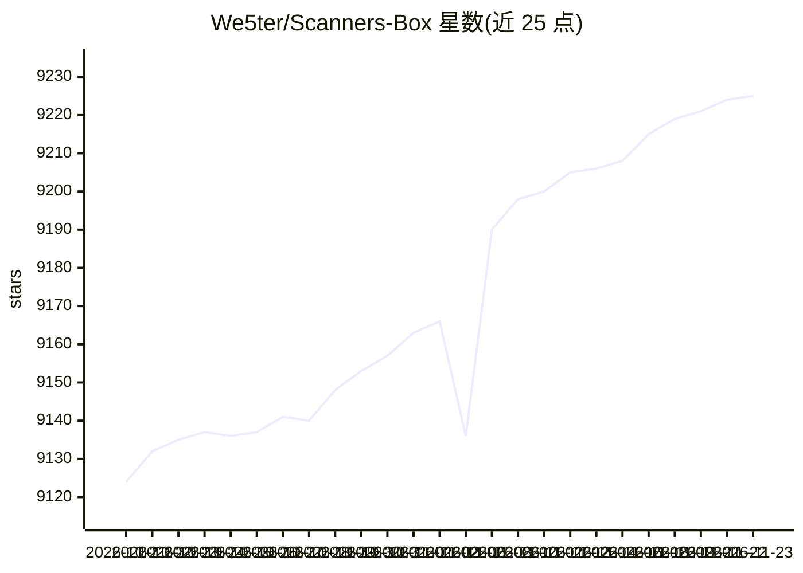

# We5ter/Scanners-Box

⭐ 9,225 · NOASSERTION · 推送 2026-11-18 · [GitHub](https://github.com/We5ter/Scanners-Box) · [官网](https://we5ter.github.io/ai-tools/) · 个人维护 · 中文 README

**面向极客、企业与 AI 智能体的开源安全工具矩阵清单**

以清单形式收录开源网络安全工具，按类别组织：AI 红队框架与渗透 Agent、LLM 驱动的漏洞扫描器、面向 AI 应用与 Agent 的安全审计工具、AI 基础设施攻击面发现、Agent 运行时控制（沙箱/策略引擎）、Agent 技能安全扫描与技能包、智能合约扫描器、AI 安全基准与验证标准等。条目为外部仓库链接加功能描述，并附 star/commit 徽章；另提供 Daily AI Tool Picks 与 MCP Server 页面入口。

## 筛选速览

| 维度 | 判定 | 备注 |
|---|---|---|
| AI 角色 | `ai-knowledge` | 知识聚合/清单类 |
| 许可风险 | `none` | NOASSERTION |
| 部署形态 | `None` |  |
| 模型依赖 | — | README 未给出锁定关系 |
| 硬件要求 | — | 无带数字的原话,不猜 |
| 安装摩擦 | `low` | 无编译、无系统依赖或容器化 |
| 成熟度 | — | 结构信号不足 |

## 能力要点

- 按 AI 红队、漏洞扫描、AI 审计、运行时控制等类别组织的工具矩阵
- 收录对象覆盖 LLM 系统红队、MCP 服务器风险检测、Agent 技能包恶意模式扫描
- 附 GitHub star 与最近提交徽章
- 提供 Daily AI Tool Picks 与 ScanCodex MCP Server 入口

## 适用场景

- 为红队/渗透测试工作寻找可用的开源 AI 工具
- 评估部署前 AI Agent 系统的安全风险
- 查找针对 LLM 应用的提示注入与越狱检测工具
- 为智能合约做安全分析选型

## 场景标签

`网络安全` `精选清单` · 领域:学习与行业

## 证据(README 行号)

> L10: ## Introduction
> L23: ### AI Red Teaming Frameworks & Agents
> L67: ### LLM-Powered Vulnerability Scanners

## 星数曲线

2026-10-21 9,124 → 2026-11-23 9,225（+101）

---
*卡片 v1 · prompt 1.4 · 生成 2026-11-22 · 置信度 high · 依据 README sha `53cb3621b8a3` · [字段定义](../../DATASET.md)*
