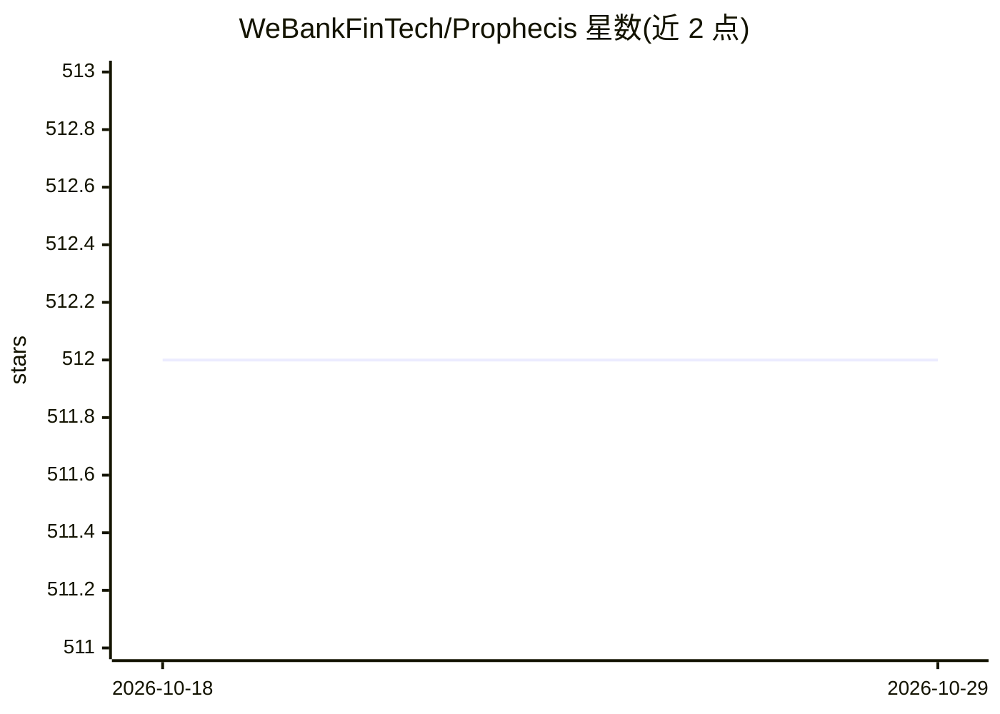

# WeBankFinTech/Prophecis

⭐ 512 · Go · Apache-2.0 · 推送 2026-09-24 · [GitHub](https://github.com/WeBankFinTech/Prophecis) · [官网](https://github.com/WeBankFinTech/Prophecis) · 组织维护 · 中文 README

**微众银行开源的一站式云原生机器学习平台**

微众银行开发的一站式机器学习平台，面向企业生产环境，提供全栈容器化部署与管理。由五个核心服务组成：MLFlow 分布式建模训练（支持 Tensorflow/Python/XGBoost）、MLLabis 基于 JupyterLab 的在线 IDE（支持 GPU 与 Hadoop 集群任务、Python/R/Julia）、Model Factory 模型存储与一键部署（RESTful/RPC）、Data Factory 特征工程与数据标注、Application Factory 基于 KubeSphere 定制的 CI/CD 与 GPU 集群监控。支持机器学习计算集群多租户管理。

## 筛选速览

| 维度 | 判定 | 备注 |
|---|---|---|
| AI 角色 | `ai-ecosystem` | LLM/agent 周边工具 |
| 许可风险 | `permissive` | Apache-2.0 |
| 部署形态 | `None` |  |
| 模型依赖 | — | README 未给出锁定关系 |
| 硬件要求 | — | 无带数字的原话,不猜 |
| 安装摩擦 | `low` | 无编译、无系统依赖或容器化 |
| 成熟度 | — | 结构信号不足 |

## 能力要点

- 五大服务覆盖建模、在线开发、模型部署、特征工程与 DevOps
- MLLabis 在线 IDE 支持 GPU/Hadoop 集群任务与 Python/R/Julia
- 模型一键部署为 RESTful API 或 RPC 接口
- 计算集群多租户管理与全栈容器化部署

## 适用场景

- 企业搭建覆盖数据到模型部署全流程的机器学习平台
- 团队在 GPU/Hadoop 集群上进行多租户模型训练
- 将训练产出的模型一键发布为业务系统可调用的 API

## 场景标签

`模型训练` `MLOps` · 领域:训练与推理

## 证据(README 行号)

> L9: Prophecis is a one-stop machine learning platform developed by WeBank. It integrates multiple open-source machine le
> L17: - **Prophecis Machine Learning Flow**：Distributed machine learning modeling tool, with stand-alone and distributed 
> L19: - **Prophecis MLLabis**：Machine learning development and exploration tools, providing development and exploration s

## 星数曲线

2026-10-18 512 → 2026-10-29 512（+0）

---
*卡片 v1 · prompt 1.4 · 生成 2026-10-21 · 置信度 high · 依据 README sha `3e2eb2a9f567` · [字段定义](../../DATASET.md)*
