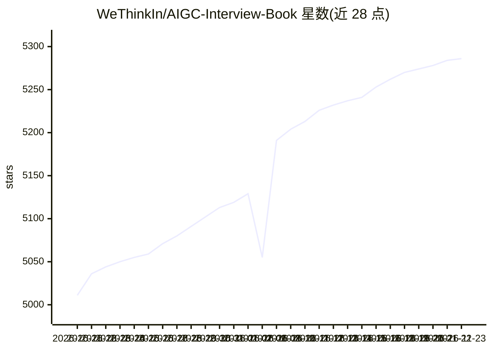

# WeThinkIn/AIGC-Interview-Book

⭐ 5,286 · Python · GPL-3.0 · 推送 2026-11-22 · [GitHub](https://github.com/WeThinkIn/AIGC-Interview-Book) · [官网](https://wethinkin.github.io/AIGC-Interview-Book/) · 个人维护 · 中文 README

**面向AI求职者的AIGC/LLM/Agent面试知识平台**

以知识库形式组织的AI行业面试与职业成长平台，内容按AIGC算法岗、开发岗、应用岗三个方向编排，覆盖面试经验指南、AIGC图像/视频、大模型、多模态、AI Agent、模型部署、编程基础等核心知识板块，并提供面试50问、复习路线、求职冲刺路线等教程。内容由主编与多位副主编持续维护，社区通过 Issue/PR 投稿面经、题库与章节更新，另设付费进阶服务社区提供答疑、模拟面试、内推等。

## 筛选速览

| 维度 | 判定 | 备注 |
|---|---|---|
| AI 角色 | `ai-knowledge` | 知识聚合/清单类 |
| 许可风险 | `viral` | GPL-3.0 |
| 部署形态 | `None` |  |
| 模型依赖 | — | README 未给出锁定关系 |
| 硬件要求 | — | 无带数字的原话,不猜 |
| 安装摩擦 | `low` | 无编译、无系统依赖或容器化 |
| 成熟度 | — | 结构信号不足 |

## 能力要点

- 按算法岗/开发岗/应用岗三个方向组织面试知识体系
- 包含AI Agent、多模态、大模型等多条面试复习路线
- 通过 Issue/PR 接收面经、题库、章节纠错等共建投稿
- 每季度发布AIGC面试趋势报告与月度贡献者榜单

## 适用场景

- 准备AIGC/LLM/Agent算法岗笔试面试
- 从传统CV/NLP转向大模型方向的复习规划
- 查找AI岗位招聘信息与技术栈要求
- 作为高校AI相关专业的教学参考源

## 场景标签

`教程课程` · 领域:学习与行业

## 证据(README 行号)

> L23: ## 📖目录
> L47: ### 🧭热门AI学习教程精选
> L176: |面经投稿|真实面试流程、核心问题、经验总结、个人复盘与岗位信息等|按公司、岗位、时间、轮次整理的结构化面经|

## 星数曲线

2026-10-21 5,011 → 2026-11-23 5,286（+275）

---
*卡片 v1 · prompt 1.4 · 生成 2026-11-22 · 置信度 high · 依据 README sha `742f3ecdcb39` · [字段定义](../../DATASET.md)*
