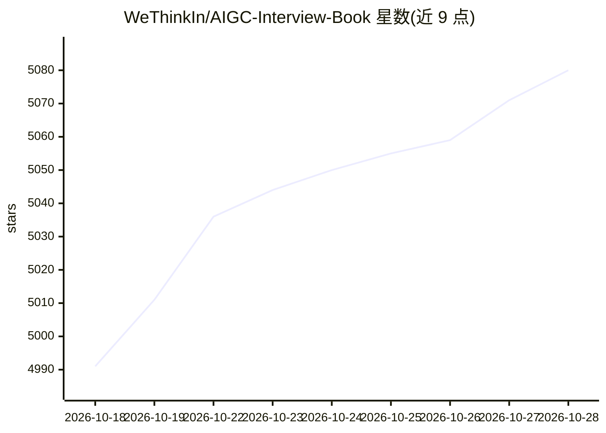

# WeThinkIn/AIGC-Interview-Book

⭐ 5,080 · Python · GPL-3.0 · 推送 2026-10-27 · [GitHub](https://github.com/WeThinkIn/AIGC-Interview-Book) · [官网](https://wethinkin.github.io/AIGC-Interview-Book/) · 组织维护 · 中文 README

**AIGC/LLM/AI Agent 算法岗面试求职与职业成长知识平台**

由 Rocky Ding 主编、多位副主编共建的 AIGC 行业面试求职知识库：内容覆盖 AIGC 图像/视频、大模型、多模态、AI Agent、模型部署、深度学习/机器学习基础等知识板块，并整理大厂高频面试题、面经、薪资爆料与内推信息。提供按岗位方向（算法岗/开发岗/应用岗）划分的复习路线和 30/60 天冲刺路线。配套 AIGCmagic 知识星球社区提供答疑、简历诊断、模拟面试等付费服务，通过 PR/Issue 接受社区共创投稿，并计划按月发布贡献者榜单、按季度发布 AIGC 面试趋势报告。

## 筛选速览

| 维度 | 判定 | 备注 |
|---|---|---|
| AI 角色 | `ai-knowledge` | 知识聚合/清单类 |
| 许可风险 | `viral` | GPL-3.0 |
| 部署形态 | `None` |  |
| 模型依赖 | — | README 未给出锁定关系 |
| 硬件要求 | — | 无带数字的原话,不猜 |
| 安装摩擦 | `low` | 无编译、无系统依赖或容器化 |
| 成熟度 | — | 结构信号不足 |

## 能力要点

- 覆盖 AIGC/LLM/AI Agent/传统深度学习等方向的面试知识板块与大厂高频面试题
- 提供算法岗/开发岗/应用岗三类岗位方向和多条面试复习路线
- 通过 PR/Issue 共创机制接受面经、题库与章节更新投稿
- 计划按季度发布基于面经与岗位 JD 的 AIGC 面试趋势报告

## 适用场景

- 准备 AIGC/LLM/AI Agent 算法岗或开发岗的校招/社招面试
- 按 30/60 天路线系统复习大模型、多模态与 Agent 知识
- 查找 AI 岗位面经、薪资信息与内推机会
- 作为高校 AIGC 相关专业的教学与学习参考资料

## 场景标签

`教程课程` · 领域:学习与行业

## 证据(README 行号)

> L25: 🏆**AIGC算法岗方向：** 涵盖AIGC、LLM大模型、AI Agent、具身智能、传统深度学习、自动驾驶、计算机视觉、自然语言处理、机器学习、强化学习、大数据挖掘、世界模型、元宇宙、AGI等。
> L31: 🚀**本项目平台凝聚了AIGC时代众多一线AIGC/LLM/AI Agent算法专家们的行业经验与深度洞察**，涵盖AIGC/LLM/AI Agent等前沿AI技术的完整知识架构、AI实战课程&教程、AI大厂内推、AI面试经验、A
> L41: - :star: AI行业面试求职经验指南（包含简历模版、求职攻略、面试经验、面试技巧等通用AI岗位面试技巧）

## 星数曲线

2026-10-18 4,991 → 2026-10-28 5,080（+89）

---
*卡片 v1 · prompt 1.4 · 生成 2026-10-20 · 置信度 high · 依据 README sha `04e5425c527c` · [字段定义](../../DATASET.md)*
