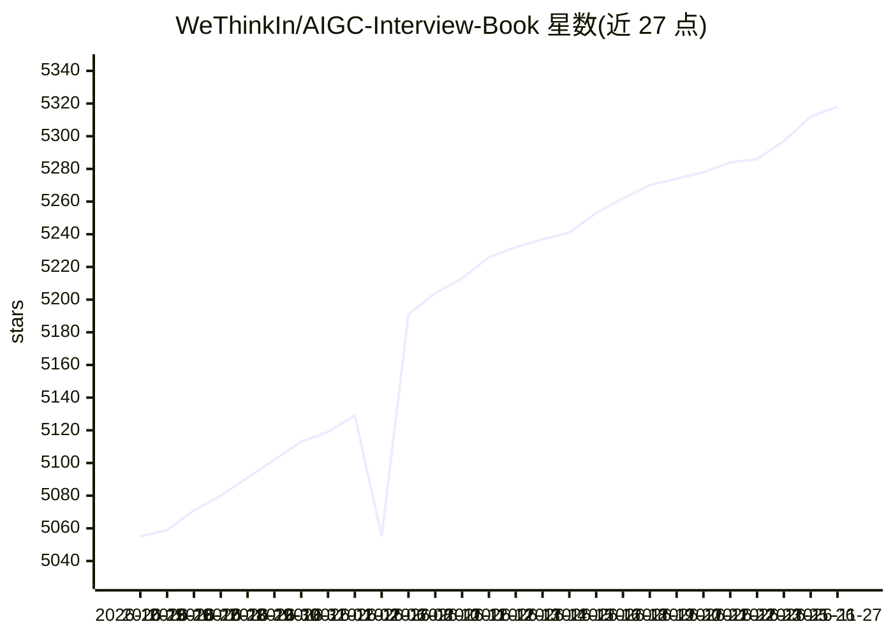

# WeThinkIn/AIGC-Interview-Book

⭐ 5,318 · Python · GPL-3.0 · 推送 2026-11-26 · [GitHub](https://github.com/WeThinkIn/AIGC-Interview-Book) · [官网](https://wethinkin.github.io/AIGC-Interview-Book/) · 个人维护 · 中文 README

**面向AI求职者的AIGC/LLM/Agent面试知识平台**

以仓库和社区形式组织的AI行业面试求职知识库：内容覆盖AIGC、大模型、AI Agent、深度学习、CV/NLP、自动驾驶等方向的面试题、面经、学习路线与职业生涯规划。核心知识板块按岗位方向（算法岗/开发岗/应用岗）划分，附高频面试题清单与30-60天复习路线；通过PR/Issue接收面经与题库共建，并运营付费进阶服务社区（答疑、内推、模拟面试）。README未包含安装或运行说明，纯内容项目。

## 筛选速览

| 维度 | 判定 | 备注 |
|---|---|---|
| AI 角色 | `ai-knowledge` | 知识聚合/清单类 |
| 许可风险 | `viral` | GPL-3.0 |
| 部署形态 | `None` |  |
| 模型依赖 | — | README 未给出锁定关系 |
| 硬件要求 | — | 无带数字的原话,不猜 |
| 安装摩擦 | `low` | 无编译、无系统依赖或容器化 |
| 成熟度 | — | 结构信号不足 |

## 能力要点

- 覆盖AIGC/LLM/AI Agent等方向的面试题与面经知识板块
- 提供多套按岗位与周期组织的学习路线（30天冲刺、60天系统路线等）
- 通过PR/Issue共建机制收集面经、题库与章节纠错
- 按季度发布AIGC面试趋势报告与月度贡献者榜单

## 适用场景

- 准备AIGC/LLM/AI Agent算法岗或开发岗的笔试面试
- 按30/60天路线规划大模型或多模态方向的复习
- 查找大厂高频面试题与简历、求职攻略素材

## 场景标签

`教程课程` · 领域:学习与行业

## 证据(README 行号)

> L1: # 🔥【三年面试五年模拟】AIGC/LLM/AI Agent算法岗/开发岗的面试求职和职业生涯成长平台
> L41: - :star: AI行业面试求职经验指南（包含简历模版、求职攻略、面试经验、面试技巧等通用AI岗位面试技巧）
> L55: - :boom: 大厂高频面试题（实时更新）

## 星数曲线

2026-10-25 5,055 → 2026-11-27 5,318（+263）

---
*卡片 v1 · prompt 1.4 · 生成 2026-11-24 · 置信度 high · 依据 README sha `4609282637a2` · [字段定义](../../DATASET.md)*
