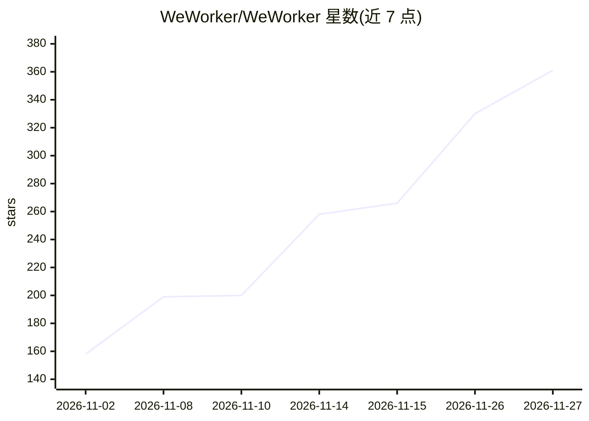

# WeWorker/WeWorker

⭐ 361 · JavaScript · Apache-2.0 · 推送 2026-11-26 · [GitHub](https://github.com/WeWorker/WeWorker) · [官网](https://www.weworker.cc) · 组织维护 · 中文 README

**桌面 AI agent：自然语言驱动浏览器在网站执行实际操作**

Electron 桌面应用，将自然语言请求转换为真实网站操作：AI agent 选择 Adapter，通过 Chrome 扩展或内置 Toolkit 运行时执行，统一经 webcli call 入口调用。内置 33 个网站 Adapter，覆盖邮箱、购物、社交、内容、开发者工具等站点，另提供网站探索 agent 用于创建与维护 Adapter，支持定时任务、通知推送与本地站点记忆。登录、提交、支付等关键步骤由用户控制；任务内容会发送至用户所选的模型服务商。

## 筛选速览

| 维度 | 判定 | 备注 |
|---|---|---|
| AI 角色 | `ai-native` | 本体是模型或模型工具 |
| 许可风险 | `permissive` | Apache-2.0 |
| 部署形态 | `desktop` | 安装包/桌面程序 |
| 模型依赖 | locked-api |  |
| 硬件要求 | — | 无带数字的原话,不猜 |
| 安装摩擦 | `low` | 无编译、无系统依赖或容器化 |
| 成熟度 | — | 结构信号不足 |

## 能力要点

- 33 个内置网站 Adapter，覆盖邮箱、购物、社交、内容等站点
- 双运行时：Chrome 扩展 Adapter 与内置 Toolkit Adapter，共用 webcli call 入口
- 网站探索 agent：辅助创建、验证与维护 Adapter
- 支持定时任务、通知渠道与本地站点记忆

## 适用场景

- 跨网站收集、对比并汇总信息
- 自动查邮件、搜索内容、填写表单和运行定时任务
- 用 Adapter 描述网站工具并通过统一命令行调用
- 为常用网站贡献新的 Adapter

## 场景标签

`浏览器自动化` `AI 助手` · 领域:效率与自动化

## 证据(README 行号)

> L21: WeWorker turns a natural-language request into real website actions. Its AI agent selects an Adapter and operates t
> L47: - **Multiple model providers:** Anthropic, Zhipu, DeepSeek, and compatible custom endpoints.

## 星数曲线

2026-11-02 158 → 2026-11-27 361（+203）

---
*卡片 v1 · prompt 1.4 · 生成 2026-11-27 · 置信度 high · 依据 README sha `0cb4157693c0` · [字段定义](../../DATASET.md)*
